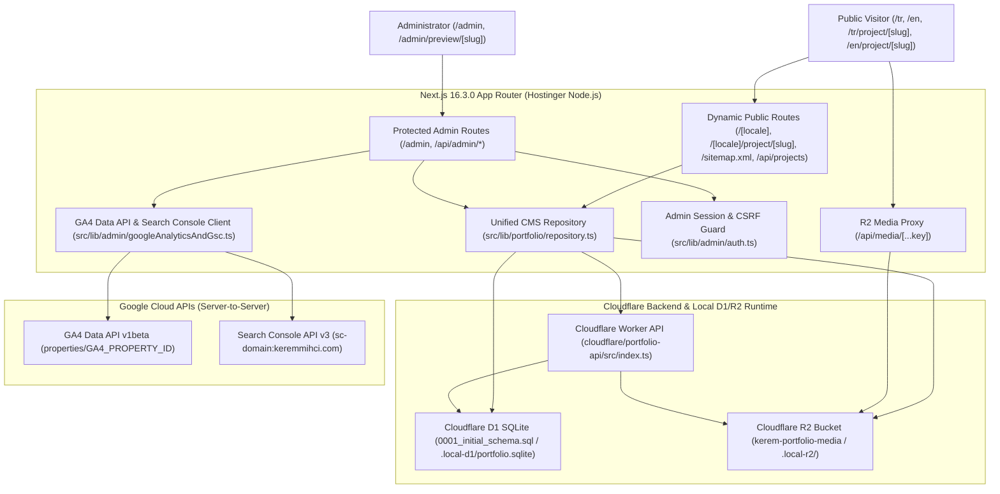

# Kerem Mıhçı Portfolio OS — Engineering Audit & Architecture Map

## 1. System Architecture Map

### Core Subsystems
- **Public Portfolio OS Shell (`src/components/shell/ResponsiveShell.tsx`)**:
  - Preserves the macOS-inspired Portfolio OS experience with three workspaces (`design`, `web`, `motion-ai`), light/dark wallpapers, desktop Dock, two-row mobile Dock, draggable desktop project icons, and multi-window applications (`Notes`, `Projects`, `Gallery`, `Videos`, `Contact`, `About`, `CV`, `Trash`, `ToolInfo`).
  - Hydrates live published projects from the D1 CMS repository into `useSessionStore` (`src/store/sessionStore.ts`) without requiring a Next.js rebuild or redeploy.
- **Desktop & Mobile Spatial Placement (`src/lib/desktopPlacement.ts`, `src/lib/mobilePlacement.ts`)**:
  - Automatic spawn uses deterministic Mulberry32 PRNG per session seed with 8px minimum collision gap, natural thumbnail aspect ratios, safe viewport boundaries, and Dock protection.
  - Manual dragging allows intentional overlap and icon stacking (`manualPlacements` in `sessionStore.ts`) without snap-back or post-drop repulsion.
- **Videos / Reels (`src/data/videos.ts`, `src/components/applications/VideoApp.tsx`)**:
  - Preserves all 21 reels (19 portrait `9:16` + 2 landscape `16:9` included in the unified Reels feed), playback pause on unmount/close, and project deep-linking via `useSessionStore((s) => s.rawProjects)`.

---

## 2. Website Quality Audit Findings & Remediation Status

| ID | Priority | Classification | Component / File | Observed Symptom & Root Cause | Solution Implemented | Status |
| :--- | :--- | :--- | :--- | :--- | :--- | :--- |
| **AUD-01** | **P1** | CONFIRMED DEFECT | `src/app/[locale]/page.tsx` | **Soft-404 on unknown single-segment paths**: Visiting `/unknown-path` matched `[locale]` without checking `isValidLocale(locale)` and returned HTTP `200 OK` with Turkish homepage content and `/tr` canonical URL. | Added `if (!isValidLocale(locale)) notFound();` in `LocaleDesktopPage` and `generateMetadata`. | `COMPLETE_VERIFIED` |
| **AUD-02** | **P1** | CONFIRMED DEFECT | `src/app/[locale]/project/[slug]/page.tsx` | **Unvalidated locale & missing structured data on project routes**: Visiting `/de/project/<slug>` silently rendered Turkish content instead of 404; project pages lacked `CreativeWork` JSON-LD and semantic `<article>` landmarks. | Added `isValidLocale(locale)` check calling `notFound()`, added `generateProjectJsonLd()` (`@type: CreativeWork`), and added `<article className="sr-only">` semantic landmark. | `COMPLETE_VERIFIED` |
| **AUD-03** | **P1** | CONFIRMED DEFECT | `src/app/[locale]/project/[slug]/ClientDeepLinkProjectPage.tsx` | **Deep-link window ID mismatch**: Opened project window with `id: "project-" + project.id` whereas `DesktopIcon`, `MobileWorkspace`, `ProjectsApp`, and `VideoDetail` all check `id: "project-" + project.slug`, allowing duplicate windows when clicking desktop icons after deep-linking. | Unified window ID in `ClientDeepLinkProjectPage.tsx` to `id: "project-" + project.slug`. | `COMPLETE_VERIFIED` |
| **AUD-04** | **P1** | CONFIRMED DEFECT | `src/components/desktop/DesktopIcon.tsx` & `src/lib/seo.ts` | **External / R2 URL blocker**: `DesktopIcon.tsx` checked `thumbnailSrc.startsWith("/")`, preventing `https://` R2 URLs from rendering as desktop thumbnails. `buildAbsoluteUrl` in `src/lib/seo.ts` prefixed `https://keremmihci.com` onto already-absolute `https://` URLs. | Updated `DesktopIcon.tsx` to allow `/`, `http://`, and `https://`. Updated `buildAbsoluteUrl` in `src/lib/seo.ts` to return `http://` and `https://` URLs unchanged. | `COMPLETE_VERIFIED` |
| **AUD-05** | **P1** | CONFIRMED DEFECT | `DesktopWorkspace.tsx`, `MobileWorkspace.tsx`, `WindowManager.tsx`, `MobileWindow.tsx`, `VideoDetail.tsx` | **Static `projectsData` import blocked dynamic CMS updates**: Client workspace and window components imported `projectsData` directly from `@/data/projects` rather than reading hydrated CMS projects from `sessionStore`. | Added `rawProjects` and `hydrateProjects(projects)` to `src/store/sessionStore.ts` and updated all workspace/window components to read `rawProjects` from `useSessionStore`. | `COMPLETE_VERIFIED` |
| **AUD-06** | **P1** | CONFIRMED DEFECT | `src/app/robots.ts` & `src/components/analytics/GoogleAnalytics.tsx` | **Admin route crawler & analytics isolation**: `/robots.txt` did not disallow `/admin`, and `GoogleAnalytics.tsx` mounted `ConsentBanner` and GA4 scripts globally on `/admin`. | Added `"/admin"` and `"/admin/"` to `disallow` in `src/app/robots.ts`, added `X-Robots-Tag: noindex, nofollow` headers in `next.config.mjs`, and suppressed `GoogleAnalytics` when `pathname.startsWith("/admin")`. | `COMPLETE_VERIFIED` |
| **AUD-07** | **P2** | CONFIRMED DEFECT | `src/components/applications/ProjectsApp.tsx` | **Missing grid thumbnail fallback**: Grid view only checked `project.desktopIcon`, falling back to text `"FILE"` even when `project.thumbnail` or `project.cover` existed. | Updated grid view to check `project.desktopIcon \|\| project.thumbnail \|\| project.desktopThumbnail?.src \|\| project.cover`. | `COMPLETE_VERIFIED` |
| **AUD-08** | **P2** | CONFIRMED DEFECT | `src/components/mobile/MobileToolsShelf.tsx` | **Tool window title localization overwrite**: Opening a tool window on mobile assigned the current locale's title to both `titleTR` and `titleEN`, preventing dynamic title updates when switching languages. | Passed `titleTR: info.titleTR` and `titleEN: info.titleEN` distinctly. | `COMPLETE_VERIFIED` |
