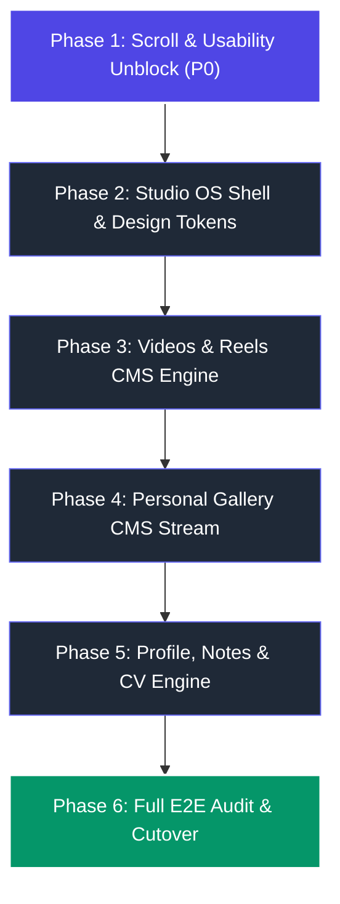

# Portfolio OS: Complete CMS Implementation Roadmap
## Phased Engineering Plan: From Technical Prototype to Creative Studio OS

**Date:** October 20, 2026  
**Status:** Engineering Roadmap & Execution Specification  
**Architecture:** Next.js 14 + Cloudflare Workers + D1 Database + R2 Object Storage  
**Branch:** `feature/cloudflare-cms-dashboard`  
**Execution Style:** Incremental, non-destructive, evidence-verified at every stage.

---

## 1. Roadmap Architecture & Execution Principles

To ensure zero risk to existing staging and production environments, the transformation of the Portfolio OS CMS is organized into **6 sequential, independently verifiable phases**:

### Core Execution Principles:
1. **Never Break Canonical Data**: The 30 published projects and 21 portfolio videos must remain intact and functional at every milestone.
2. **Atomic Route Scoping**: Fixes applied to `/admin` must never alter the windowed, zero-scroll behavior of the public desktop portfolio.
3. **Automated Verification Gates**: Each phase requires an automated test script confirming its acceptance criteria before advancing to the next phase.

---

## 2. Phase-by-Phase Implementation Specifications

### Phase 1: Scroll & Usability Unblock (P0 Priority)
* **Objective**: Remove the critical usability blocker preventing downward vertical scrolling across all admin screens and clean staging data integrity.
* **Key Tasks**:
  1. Refactor `src/app/admin/layout.tsx` to establish a strict viewport boundary: `h-[100dvh] max-h-[100dvh] overflow-hidden`.
  2. Refactor `AdminDashboardClient.tsx` `<main>` workspace container to `flex-1 min-h-0 overflow-y-auto`.
  3. Ensure mobile header/drawer allows unified vertical scrolling on viewports `390x844` and `375x812`.
  4. Fix Featured Manager project filter to require `cmsStatus === 'published'` (line 1752), preventing draft leakage.
  5. Delete leaked test draft `staging-e2e-29cbd44d` from staging D1 via safe targeted query.
  6. Verify reconciliation state resets to green.
* **Acceptance Criteria**:
  - Headless Playwright scroll diagnostic demonstrates `scrollTop > 0` on all 7 screens across all 6 test viewports.
  - Test draft `staging-e2e-29cbd44d` no longer appears in Featured Manager.
  - Staging System screen displays `Canonical Reconciliation: Reconciled (30/30)`.
* **Estimated Effort**: 1 day.

---

### Phase 2: Design System & Modular Studio Shell
* **Objective**: Replace the monolithic 2,600-line `AdminDashboardClient.tsx` with a modular component architecture adhering to the "Studio OS" design specification.
* **Key Tasks**:
  1. Implement Tailwind design tokens for "Studio OS" surfaces, borders, and typography.
  2. Create modular layout components:
     - `StudioShell.tsx` (Viewport constraint, global toasts, status bar)
     - `StudioSidebar.tsx` (Categorized collapsible navigation with icons)
     - `StudioHeader.tsx` (Breadcrumbs, active user, sync indicator)
  3. Extract core screens into dedicated module files:
     - `OverviewDashboard.tsx`
     - `ProjectCatalog.tsx`
     - `MediaLibraryView.tsx`
     - `FeaturedSpotlightView.tsx`
     - `SystemHealthView.tsx`
  4. Implement synchronized side-by-side bilingual editor for projects (`ProjectSplitEditor.tsx`).
* **Acceptance Criteria**:
  - `AdminDashboardClient.tsx` reduced to an orchestrator under 300 lines.
  - High-contrast, tactile dark-graphite aesthetic verified in browser screenshots.
  - Bilingual editor allows simultaneous viewing of Turkish and English copy.
* **Estimated Effort**: 2 days.

---

### Phase 3: Videos & Reels CMS Engine
* **Objective**: Transform 21 static video assets into a fully manageable Cloudflare D1/R2 video pipeline.
* **Key Tasks**:
  1. Apply D1 migration `0002_expand_content_schema.sql` adding `videos` and `video_translations` tables.
  2. Implement Worker API endpoints:
     - `GET /api/v1/admin/videos` (List with sorting and filters)
     - `POST /api/v1/admin/videos` (Create video record)
     - `PATCH /api/v1/admin/videos/:id` (Update metadata/translations)
     - `PUT /api/v1/admin/videos/reorder` (Batch update `sort_order`)
     - `DELETE /api/v1/admin/videos/:id` (Soft/hard delete)
  3. Run initial seed script importing all 21 videos from `src/data/videos.ts` into staging D1.
  4. Build `VideoReelsStudio.tsx` in admin dashboard with 9:16 vertical cards, 16:9 landscape cards, and drag-and-drop reordering.
  5. Remove `shuffleArray()` from public `src/stores/sessionStore.ts`, restoring respect for curator sort order.
* **Acceptance Criteria**:
  - All 21 videos visible and playable in Admin Videos Studio.
  - Drag-and-drop reordering persists to D1 and reflects immediately on public video player.
  - Posters and titles editable directly from the dashboard.
* **Estimated Effort**: 2 days.

---

### Phase 4: Personal Gallery CMS Stream
* **Objective**: Enable full management of the public single-column vertical creative gallery feed.
* **Key Tasks**:
  1. Apply D1 schema for `gallery_items` and `gallery_translations`.
  2. Implement Worker API endpoints:
     - `GET /api/v1/admin/gallery`
     - `POST /api/v1/admin/gallery`
     - `PATCH /api/v1/admin/gallery/:id`
     - `PUT /api/v1/admin/gallery/reorder`
     - `DELETE /api/v1/admin/gallery/:id`
  3. Build `GalleryFeedCurator.tsx` in admin dashboard with single-column visual cards, inline caption editing, and sort drag handles.
  4. Update public `GalleryApp.tsx` and `sessionStore.ts` to fetch sequential items from Worker API with static fallback.
* **Acceptance Criteria**:
  - Creator can upload photography series, set bilingual captions, and reorder the sequence.
  - Public Gallery application displays images in the exact curated order.
* **Estimated Effort**: 1.5 days.

---

### Phase 5: Profile, Notes & CV CMS Engine
* **Objective**: Make all biography tabs in `NotesApp.tsx` and CV PDF downloads dynamically manageable through the dashboard.
* **Key Tasks**:
  1. Apply D1 schema for `profile_sections`, `profile_translations`, `profile_timeline_items`, and `cv_documents`.
  2. Extend Worker media upload pipeline to support `application/pdf` with 15MB limit and secure content headers.
  3. Implement Worker API endpoints:
     - `GET /api/v1/admin/profile` & `PUT /api/v1/admin/profile`
     - `GET /api/v1/admin/cv` & `POST /api/v1/admin/cv/upload`
  4. Build `ProfileNotesEditor.tsx` in admin dashboard supporting Markdown editing for About, Experience, Education, Skills, and Notes.
  5. Build `CvManager.tsx` with drag-and-drop PDF upload, active version selection, and download verification links.
  6. Update public `NotesApp.tsx` to read dynamic profile data.
* **Acceptance Criteria**:
  - Creator can upload updated TR and EN resumes without source code changes.
  - Biography, experience, and notes editable via dashboard and reflected in public Notes app.
* **Estimated Effort**: 2 days.

---

### Phase 6: E2E Verification, Hardening & Production Cutover
* **Objective**: Execute automated test verification across all modules, conduct security preflight, and prepare production deployment.
* **Key Tasks**:
  1. Write and execute complete end-to-end integration test suite (`scripts/verify-full-cms-e2e.mjs`) testing all 5 modules against Cloudflare staging.
  2. Perform visual regression testing across desktop, tablet, and mobile breakpoints.
  3. Execute automated secret scan verifying zero leaked credentials.
  4. Deploy D1 migrations and Worker API code to Cloudflare production.
  5. Trigger production website deployment on Hostinger via GitHub Actions / webhook.
* **Acceptance Criteria**:
  - 100% of automated E2E tests pass.
  - Production site loads dynamic content with zero downtime or broken assets.
  - Zero TypeScript, ESLint, or Webpack build warnings.
* **Estimated Effort**: 1.5 days.

---

## 3. Risk Matrix & Mitigation Strategy

| Identified Risk | Severity | Impact | Mitigation Strategy |
|---|---|---|---|
| Accidental deletion of 30 canonical projects | HIGH | Destruction of live portfolio works | Schema migrations are strictly additive. Database queries are executed with explicit parameterized IDs. Staging D1 backup snapshot taken prior to migration. |
| Admin scroll fix leaking into public Portfolio OS | HIGH | Public macOS window system breaks or gets double scrollbars | Layout styling is strictly isolated to `src/app/admin/*`. Public desktop layouts in `src/app/page.tsx` remain completely untouched. |
| Public site failure if Cloudflare API is unreachable | MEDIUM | Blank screen or broken media on public site | Frontend components implement a robust fallback: if API fetch fails or times out (3000ms), site gracefully serves static TypeScript data (`canonicalProjects.ts`, `videos.ts`, `profile.ts`). |
| PDF upload security vulnerability | MEDIUM | Arbitrary file upload to R2 | Cloudflare Worker validates magic bytes, restricts file extension to `.pdf`, limits size to 15MB, and sets `Content-Type: application/pdf` and `Content-Disposition: inline` headers. |

---

## 4. Total Roadmap Timeline & Milestone Schedule

| Phase | Description | Duration | Target Deliverable |
|---|---|---|---|
| **Phase 1** | Scroll & Usability Unblock | Day 1 | Fully scrollable admin UI, green staging reconciliation |
| **Phase 2** | Studio OS Design System | Days 2–3 | High-end dark graphite UI, modular components, split editor |
| **Phase 3** | Videos & Reels CMS | Days 4–5 | 21 videos manageable in D1/R2, sequential playback |
| **Phase 4** | Personal Gallery CMS | Days 6–7 | Sequential photo stream curator, bilingual captions |
| **Phase 5** | Profile, Notes & CV CMS | Days 8–9 | Dynamic Notes app, PDF resume upload engine |
| **Phase 6** | E2E Audit & Cutover | Day 10 | 100% verified staging test suite, production cutover |

---

## 5. Next Immediate Action

Awaiting creator approval on the complete audit findings and this 6-phase roadmap. Upon confirmation, **Phase 1 (Scroll & Usability Unblock)** can be executed immediately on the `feature/cloudflare-cms-dashboard` branch.
