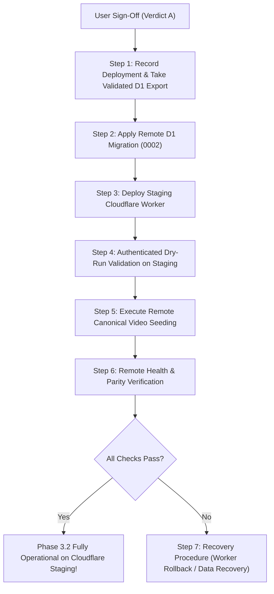

# Portfolio OS Phase 3 & 3.2: Cloudflare Staging Deployment & Approval Plan

**Author:** Antigravity Autonomous Agent<br/>
**Branch:** `feature/cloudflare-cms-dashboard`<br/>
**Current Local Head:** Phase 3.2 Final Staging Safety Gate Verified (90/90 Tests Green)<br/>
**Remote Target:** Cloudflare Staging Worker (`kerem-mihci-portfolio-api-staging`) & D1 (`kerem-portfolio-db-staging`)<br/>
**Database ID:** `0efef7a7-cc93-4dc2-8cb7-db28379fe01f`<br/>
**R2 Bucket:** `kerem-portfolio-media-staging`<br/>
**Worker URL:** `https://kerem-mihci-portfolio-api-staging.kerem-mihci.workers.dev`<br/>
**Status:** **PENDING USER AUTHORIZATION (VERDICT A REQUIRED)**  

---

> [!IMPORTANT]
> **SAFETY COMMITMENT CONFIRMATION**:
> In strict compliance with user instructions, **ZERO remote Cloudflare D1 migrations, ZERO remote Worker deployments, and ZERO remote R2 mutations have been performed**.
> All development, additive migrations, magic byte validators, fail-closed regression tests, authenticated seed inventory checks, conservative no-store cache headers, and end-to-end verifications (**90/90 checks passed**) were conducted exclusively against isolated local SQLite and local R2 simulation.
> Remote execution will occur only when the user explicitly grants authorization by choosing **Verdict A**.

---

## 1. Scope of Remote Changes

Upon user authorization (**Verdict A**), the following atomic operations will deploy Phase 3 & 3.2 to the Cloudflare staging environment:

### 1.1 Pre-Migration Backup & Strict Validation (Safety First)
Before applying any schema changes or deployments, a complete pre-migration D1 backup must be taken and strictly validated according to rigorous criteria:

```bash
# 1. Capture current Worker deployment ID for instant zero-downtime rollback target
npx wrangler deployments list \
  --config cloudflare/portfolio-api/wrangler.jsonc \
  --env staging > /tmp/portfolio-pre-phase3-deployments.txt

# 2. Export immutable SQL dump of staging D1 to a secure path outside git
BACKUP_PATH="/tmp/portfolio-d1-staging-pre-phase3-$(date +%s).sql"

npx wrangler d1 export kerem-portfolio-db-staging \
  --config cloudflare/portfolio-api/wrangler.jsonc \
  --env staging \
  --remote \
  --output "$BACKUP_PATH"
```

#### Pre-Migration Backup Validation Checklist
The deployment must halt immediately if any of these validation criteria are not met:
1. **Exit Code**: Wrangler export command returns exit code `0`.
2. **Non-Empty**: Backup file size is strictly greater than zero (`test -s "$BACKUP_PATH"`).
3. **Expected Tables**: SQL dump contains statements for all existing production/staging tables:
   - `projects`
   - `project_translations`
   - `project_media`
   - `admin_sessions`
4. **SQL Integrity**: The exported SQL parses cleanly without syntax errors (`sqlite3 :memory: < "$BACKUP_PATH" "PRAGMA quick_check;"` or schema verification).
5. **Cryptographic Checksum**: Compute and record SHA-256 checksum:
   `shasum -a 256 "$BACKUP_PATH" > "${BACKUP_PATH}.sha256"`
6. **Location Outside Git**: Stored in `/tmp/` (never committed to repository).
7. **File Permissions**: Set restricted read/write permissions:
   `chmod 0600 "$BACKUP_PATH"` (ensures session tokens and hashes are protected).
8. **Baseline Project Count**: Verify current live database contains all 30 canonical projects:
   `npx wrangler d1 execute kerem-portfolio-db-staging --config cloudflare/portfolio-api/wrangler.jsonc --env staging --remote --command "SELECT count(*) AS project_count FROM projects;"` (must return 30).
9. **Baseline Video Count**: Confirm video count is baseline (0 before migration).

---

### 1.2 Remote D1 Migration: `0002_videos_and_reels_schema.sql`
- Applies additive schema to `kerem-portfolio-db-staging` (`0efef7a7-cc93-4dc2-8cb7-db28379fe01f`):
  1. `portfolio_videos` (id, slug, status, orientation, video_type, production_method, ai_assisted, client_name, year, duration, aspect_ratio, featured, sort_order, autoplay_preview, timestamps)
  2. `portfolio_video_translations` (id, video_id, locale, title, short_title, description, full_description, services_json, updated_at)
  3. `portfolio_video_assets` (id, video_id, asset_type, storage_mode, storage_key, public_url, mime_type, byte_size, width, height, duration_seconds, timestamps)
  4. `portfolio_video_revisions` (id, video_id, revision_number, action, snapshot_json, actor_email, created_at)
- Creates 8 performance lookup indexes.
- **Strict Non-Destructive Guarantee**: Zero modifications or deletions to existing `projects`, `project_translations`, `project_media`, or `admin_sessions` tables.

---

### 1.3 Remote Cloudflare Worker Deployment
- Records current active deployment ID prior to upload.
- Deploys updated `cloudflare/portfolio-api/src/index.ts` to `https://kerem-mihci-portfolio-api-staging.kerem-mihci.workers.dev`.
- Registers dedicated endpoints:
  - `GET /api/v1/public/health` & `GET /api/v1/health` (supporting GET and HEAD)
  - `GET /api/v1/public/videos` (with `Cache-Control: no-store, no-cache, must-revalidate`)
  - `GET /api/v1/public/videos/:slug` (immediate 404 on unpublish)
  - `GET /api/v1/public/media/*` (public streaming with HTTP 206 / 416 support and conservative `no-store, no-cache, must-revalidate`)
  - `GET /api/v1/admin/videos` (authenticated completeness calculation discovering published, draft, and archived)
  - `POST /api/v1/admin/videos` (create video draft with 409 conflict detection)
  - `GET /api/v1/admin/videos/:id` (detail inspection)
  - `PUT /api/v1/admin/videos/:id` (update metadata, status, publishing)
  - `DELETE /api/v1/admin/videos/:id` (cascaded deletion)
  - `POST /api/v1/admin/videos/reorder` (atomic batch sort order update)
  - `GET /api/v1/admin/videos/:id/revisions` (list point-in-time snapshots)
  - `POST /api/v1/admin/videos/:id/revisions` (rollback to snapshot)
  - `POST /api/v1/admin/videos/upload` (dedicated R2 video/poster upload with magic byte signature enforcement)

---

### 1.4 Remote Canonical Video Seeding
- Runs preflight check against authenticated `GET /api/v1/admin/videos`.
- Validates canonical parity in dry-run mode before seeding:
  `node scripts/import-canonical-videos-to-d1.mjs --remote-staging --dry-run`
- Seeds the 21 canonical videos (19 portrait, 2 landscape) with all 28 canonical metadata fields:
  `node scripts/import-canonical-videos-to-d1.mjs --remote-staging --execute`
- Guaranteed non-destructive: `--force` is rejected on remote staging. Existing records are preserved.

---

## 2. Step-by-Step Executable Commands



### Step 1: Pre-Migration Deployment Record & Validated Backup
```bash
# Record active deployment
npx wrangler deployments list \
  --config cloudflare/portfolio-api/wrangler.jsonc \
  --env staging

# Export and validate D1 database
BACKUP_PATH="/tmp/portfolio-d1-staging-pre-phase3-$(date +%s).sql"

npx wrangler d1 export kerem-portfolio-db-staging \
  --config cloudflare/portfolio-api/wrangler.jsonc \
  --env staging \
  --remote \
  --output "$BACKUP_PATH"

# Validate backup integrity
test -s "$BACKUP_PATH" && echo "Backup non-empty: OK"
grep -q "CREATE TABLE.*projects" "$BACKUP_PATH" && echo "Projects table present: OK"
shasum -a 256 "$BACKUP_PATH" > "${BACKUP_PATH}.sha256"
chmod 0600 "$BACKUP_PATH"
```

### Step 2: Apply Remote D1 Migration
```bash
npx wrangler d1 migrations apply kerem-portfolio-db-staging \
  --config cloudflare/portfolio-api/wrangler.jsonc \
  --env staging \
  --remote
```
*Expected Output*: `Migration 0002_videos_and_reels_schema.sql applied successfully`.

### Step 3: Deploy Cloudflare Staging Worker
```bash
npx wrangler deploy \
  --config cloudflare/portfolio-api/wrangler.jsonc \
  --env staging
```
*Expected Output*: `Uploaded kerem-mihci-portfolio-api-staging to https://kerem-mihci-portfolio-api-staging.kerem-mihci.workers.dev`.

### Step 4: Validate Remote Staging in Dry-Run Mode
```bash
node scripts/import-canonical-videos-to-d1.mjs --remote-staging --dry-run
```
*Expected Output*: Authenticates with staging admin, confirms table availability, shows pending 21 canonical insertions without writing.

### Step 5: Execute Canonical Video Seeding
```bash
node scripts/import-canonical-videos-to-d1.mjs --remote-staging --execute
```
*Expected Output*: `SUCCESS: 21/21 Canonical Videos Verified with 100% Parity`.

### Step 6: Verify Remote Staging Health & Public Endpoints
```bash
# 1. Health & Statistics Check (Worker health & D1 connectivity)
curl -s "https://kerem-mihci-portfolio-api-staging.kerem-mihci.workers.dev/api/v1/public/health" | jq .

# 2. Public Video Feed Check (21 published canonical videos)
curl -s "https://kerem-mihci-portfolio-api-staging.kerem-mihci.workers.dev/api/v1/public/videos" | jq .count

# 3. Public Single Video Check
curl -sI "https://kerem-mihci-portfolio-api-staging.kerem-mihci.workers.dev/api/v1/public/videos/ai-moda-kombin-reels"

# 4. Cache Policy Check (ensures no-store, no-cache, must-revalidate)
curl -sI "https://kerem-mihci-portfolio-api-staging.kerem-mihci.workers.dev/api/v1/public/videos" | grep -i "cache-control"
```

---

## 3. Rollback & Recovery Architecture

The system distinguishes three distinct recovery levels to ensure minimal disruption and zero data loss:

| Recovery Level | Trigger | Action | Impact on Data |
|---|---|---|---|
| **Worker Rollback** | Worker code bug or runtime routing regression | Revert Worker to previous deployment ID via `wrangler rollback` | Zero impact on database. Existing and new tables remain untouched. |
| **Schema Rollback** | Migration failure or database error | Schema `0002` is strictly additive. **NO DROP TABLE is required or permitted.** Reverting Worker stops access to video tables while project tables remain 100% functional. | Zero impact on project data. Existing 30 projects and media remain intact. |
| **Data Recovery** | Unexpected data corruption during write operations | Restore database from pre-migration backup export SQL file | Reverts staging D1 database back to exact pre-Phase 3 snapshot state. |

### 3.1 Worker Rollback Procedure (Zero Downtime)
```bash
# Roll back Cloudflare Worker to previous stable deployment version recorded in Step 1
npx wrangler rollback \
  --config cloudflare/portfolio-api/wrangler.jsonc \
  --env staging

# Verify previous Worker version is serving existing projects correctly
curl -s "https://kerem-mihci-portfolio-api-staging.kerem-mihci.workers.dev/api/v1/public/projects" | jq .count
```

### 3.2 Additive Schema Isolation (Why `DROP TABLE` is Forbidden)
> [!CAUTION]
> **NO DESTRUCTIVE `DROP TABLE` COMMANDS**:
> The `0002_videos_and_reels_schema.sql` migration creates independent tables (`portfolio_videos`, `portfolio_video_translations`, `portfolio_video_assets`, `portfolio_video_revisions`).
> It does **not** alter, constrain, or touch `projects`, `project_translations`, `project_media`, or `admin_sessions`.
> Therefore, if a Worker rollback is executed, the previous Worker code simply ignores the new video tables. Issuing raw `DROP TABLE` commands introduces severe risk of accidental collateral drops and is strictly barred from all recovery scripts.

### 3.3 Data Restoration (Disaster Recovery Only)
If catastrophic data corruption occurs during manual actions:
```bash
# Restore staging database from verified pre-migration backup
npx wrangler d1 execute kerem-portfolio-db-staging \
  --config cloudflare/portfolio-api/wrangler.jsonc \
  --env staging \
  --remote \
  --file="$BACKUP_PATH"
```
