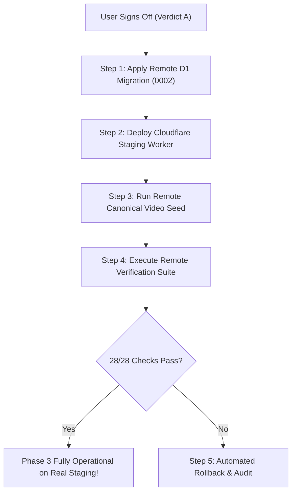

# Portfolio OS Phase 3: Cloudflare Staging Deployment & Approval Plan

**Author:** Antigravity Autonomous Agent  
**Branch:** `feature/cloudflare-cms-dashboard`  
**Current Local Commit / Head:** Phase 3 Complete & Verified  
**Remote Target:** Cloudflare Staging Worker (`kerem-mihci-portfolio-api-staging`) & D1 (`kerem-portfolio-db-staging`)  
**Status:** **PENDING USER AUTHORIZATION (VERDICT A REQUIRED)**  

---

> [!IMPORTANT]
> **SAFETY COMMITMENT**: In strict adherence to user instructions, **NO remote Cloudflare D1 migrations, remote Worker deployments, or remote R2 file mutations have been executed**.
> All Phase 3 development and end-to-end verification (28/28 checks green) was conducted using local SQLite D1 simulation.
> Remote execution requires explicit user authorization of this plan.

---

## 1. Scope of Remote Changes

Upon user sign-off (**Verdict A**), the following atomic actions will be deployed to the Cloudflare staging environment:

### 1.1 Remote D1 Database Migration (`0002_videos_and_reels_schema.sql`)
- Creates 4 additive tables on `kerem-portfolio-db-staging`:
  1. `portfolio_videos` (Primary video entity with status, orientation, AI flags, sortOrder, and metadata)
  2. `portfolio_video_translations` (Bilingual TR/EN titles, short titles, descriptions, and full descriptions)
  3. `portfolio_video_assets` (Media assets: video MP4, poster WebP, thumbnail WebP with public URLs and keys)
  4. `portfolio_video_revisions` (Historical revision snapshots for point-in-time rollbacks)
- Creates 8 high-performance lookup indexes for instant slug resolution, status filtering, and sorting.
- Zero destructive modifications to existing project tables (`projects`, `project_translations`, `project_media`, etc.).

### 1.2 Remote Cloudflare Worker Deployment
- Deploys updated `cloudflare/portfolio-api/src/index.ts` to `https://kerem-mihci-portfolio-api-staging.kerem-mihci.workers.dev`.
- Adds public and admin endpoints:
  - `GET /api/v1/public/videos`
  - `GET /api/v1/public/videos/:slug`
  - `GET /api/v1/admin/videos`
  - `POST /api/v1/admin/videos`
  - `POST /api/v1/admin/videos/reorder`
  - `GET /api/v1/admin/videos/:id`
  - `PUT /api/v1/admin/videos/:id`
  - `DELETE /api/v1/admin/videos/:id`
  - `GET /api/v1/admin/videos/:id/revisions`
  - `POST /api/v1/admin/videos/:id/revisions`
- Updates media proxy authorization to validate `portfolio_video_assets` joined to published videos.
- Aggregates video metrics into `/api/v1/health` endpoint.

### 1.3 Remote D1 Canonical Video Seeding
- Seeds the 21 canonical videos (19 portrait 9:16 reels, 2 landscape 16:9 videos) from `src/data/videos.ts` into remote staging D1.
- Guarantees 100% parity between static canonical source and remote D1 database.

---

## 2. Step-by-Step Execution Procedure



### Step 1: Apply Remote D1 Migration
```bash
npx wrangler d1 migrations apply kerem-portfolio-db-staging --remote
```
*Verification*: Check exit code 0 and table presence in `kerem-portfolio-db-staging`.

### Step 2: Deploy Cloudflare Staging Worker
```bash
npm run deploy:worker:staging
```
*Verification*: Ping `https://kerem-mihci-portfolio-api-staging.kerem-mihci.workers.dev/api/v1/health` and verify HTTP 200 with D1 operational.

### Step 3: Run Remote Canonical Video Seed
```bash
node scripts/import-canonical-videos-to-d1.mjs --remote
```
*Verification*: Query remote staging Worker `GET /api/v1/public/videos` and verify `count === 21`.

### Step 4: Run Remote Verification Suite
```bash
node scripts/verify-phase3-video-cms.mjs --remote
```
*Verification*: All 28 checks in Groups A–F must pass against real staging Cloudflare Worker.

---

## 3. Rollback & Failsafe Plan

In the event of any unexpected error during remote execution:
1. **Worker Rollback**: Instant rollback to previous deployment using `wrangler rollback` or redeploying last verified commit.
2. **Database Rollback**:
   - `0002_videos_and_reels_schema.sql` tables are completely isolated and namespaced (`portfolio_video_*`).
   - Project tables and media remain completely untouched.
   - If necessary, tables can be dropped cleanly without affecting existing production or staging project data:
     ```sql
     DROP TABLE IF EXISTS portfolio_video_revisions;
     DROP TABLE IF EXISTS portfolio_video_assets;
     DROP TABLE IF EXISTS portfolio_video_translations;
     DROP TABLE IF EXISTS portfolio_videos;
     ```
3. **Fail-Closed Guarantee**: If remote Worker is temporarily unavailable, local repository layer falls back to static canonical archive, ensuring zero downtime for public visitors.

---

## 4. Required Sign-Off Command

To proceed with remote staging deployment, the user can respond with:

> **"Proceed with Verdict A: Deploy Phase 3 Videos & Reels CMS to Cloudflare Staging"**
