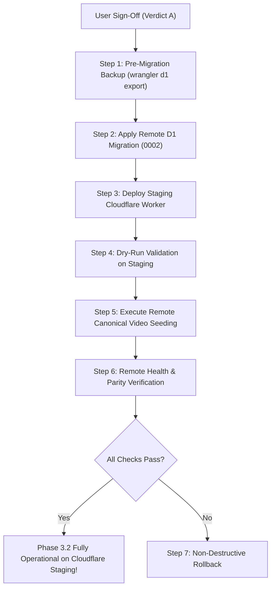

# Portfolio OS Phase 3 & 3.2: Cloudflare Staging Deployment & Approval Plan

**Author:** Antigravity Autonomous Agent  
**Branch:** `feature/cloudflare-cms-dashboard`  
**Current Local Head:** Phase 3.2 Final Staging Readiness Verified (79/79 Tests Green)<br>
**Remote Target:** Cloudflare Staging Worker (`kerem-mihci-portfolio-api-staging`) & D1 (`kerem-portfolio-db-staging`)<br>
**Database ID:** `0efef7a7-cc93-4dc2-8cb7-db28379fe01f`<br>
**Worker URL:** `https://kerem-mihci-portfolio-api-staging.kerem-mihci.workers.dev`<br>
**Status:** **PENDING USER AUTHORIZATION (VERDICT A REQUIRED)**  

---

> [!IMPORTANT]
> **SAFETY COMMITMENT CONFIRMATION**:
> In strict compliance with user instructions, **ZERO remote Cloudflare D1 migrations, ZERO remote Worker deployments, and ZERO remote R2 mutations have been performed**.
> All development, additive migrations, magic byte validators, fail-closed regression tests, and end-to-end verifications (79/79 checks passed) were conducted exclusively against isolated local SQLite and local R2 simulation.
> Remote execution will occur only when the user explicitly grants authorization by choosing **Verdict A**.

---

## 1. Scope of Remote Changes

Upon user authorization (**Verdict A**), the following atomic operations will deploy Phase 3 & 3.2 to the Cloudflare staging environment:

### 1.1 Pre-Migration Backup (Safety First)
Before applying any migration to the remote database, an immutable export of the current staging database is generated:
```bash
npx wrangler d1 export kerem-portfolio-db-staging \
  --config cloudflare/portfolio-api/wrangler.jsonc \
  --env staging \
  --remote \
  --output "backup-pre-phase3-$(date +%s).sql"
```

### 1.2 Remote D1 Migration: `0002_videos_and_reels_schema.sql`
- Applies additive schema to `kerem-portfolio-db-staging` (`0efef7a7-cc93-4dc2-8cb7-db28379fe01f`):
  1. `portfolio_videos` (id, slug, status, orientation, video_type, production_method, ai_assisted, client_name, year, duration, aspect_ratio, featured, sort_order, autoplay_preview, timestamps)
  2. `portfolio_video_translations` (id, video_id, locale, title, short_title, description, full_description, services_json, updated_at)
  3. `portfolio_video_assets` (id, video_id, asset_type, storage_mode, storage_key, public_url, mime_type, byte_size, width, height, duration_seconds, timestamps)
  4. `portfolio_video_revisions` (id, video_id, revision_number, action, snapshot_json, actor_email, created_at)
- Creates 8 performance lookup indexes.
- **Strict Non-Destructive Guarantee**: Zero modifications or deletions to existing `projects`, `project_translations`, `project_media`, or `admin_sessions` tables.

### 1.3 Remote Cloudflare Worker Deployment
- Deploys updated `cloudflare/portfolio-api/src/index.ts` to `https://kerem-mihci-portfolio-api-staging.kerem-mihci.workers.dev`.
- Registers dedicated endpoints:
  - `GET /api/v1/public/health` & `GET /api/v1/health` (supporting GET and HEAD)
  - `GET /api/v1/public/videos` (with `Cache-Control: no-store, no-cache, must-revalidate`)
  - `GET /api/v1/public/videos/:slug` (immediate 404 on unpublish)
  - `GET /api/v1/public/media/*` (public conditional streaming with HTTP 206 / 416 support and `max-age=0, must-revalidate, s-maxage=3600`)
  - `GET /api/v1/admin/videos` (authenticated completeness calculation)
  - `POST /api/v1/admin/videos` (create video draft)
  - `GET /api/v1/admin/videos/:id` (detail inspection)
  - `PUT /api/v1/admin/videos/:id` (update metadata, status, publishing)
  - `DELETE /api/v1/admin/videos/:id` (cascaded deletion)
  - `POST /api/v1/admin/videos/reorder` (atomic batch sort order update)
  - `GET /api/v1/admin/videos/:id/revisions` (list point-in-time snapshots)
  - `POST /api/v1/admin/videos/:id/revisions` (rollback to snapshot)
  - `POST /api/v1/admin/videos/upload` (dedicated R2 video/poster upload with magic byte signature enforcement)

### 1.4 Remote Canonical Video Seeding
- Validates canonical parity in dry-run mode before seeding:
  `node scripts/import-canonical-videos-to-d1.mjs --remote-staging --dry-run`
- Seeds the 21 canonical videos (19 portrait, 2 landscape) from `src/data/videos.ts` into remote staging D1:
  `node scripts/import-canonical-videos-to-d1.mjs --remote-staging --execute`
- Guaranteed non-destructive: `--force` is rejected on remote staging.

---

## 2. Step-by-Step Executable Commands



### Step 1: Pre-Migration Database Backup
```bash
npx wrangler d1 export kerem-portfolio-db-staging \
  --config cloudflare/portfolio-api/wrangler.jsonc \
  --env staging \
  --remote \
  --output "backup-pre-phase3-$(date +%s).sql"
```

### Step 2: Apply Remote D1 Migration
```bash
npx wrangler d1 migrations apply kerem-portfolio-db-staging \
  --config cloudflare/portfolio-api/wrangler.jsonc \
  --env staging \
  --remote
```
*Expected Output*: `Migration 0002_videos_and_reels_schema.sql applied successfully`.

### Step 3: Deploy Cloudflare Staging Worker
```bash
npx wrangler deploy \
  --config cloudflare/portfolio-api/wrangler.jsonc \
  --env staging
```
*Expected Output*: `Uploaded kerem-mihci-portfolio-api-staging to https://kerem-mihci-portfolio-api-staging.kerem-mihci.workers.dev`.

### Step 4: Validate Remote Staging in Dry-Run Mode
```bash
node scripts/import-canonical-videos-to-d1.mjs --remote-staging --dry-run
```
*Expected Output*: Shows current remote video count and reports pending insertions without making database modifications.

### Step 5: Execute Canonical Video Seeding
```bash
node scripts/import-canonical-videos-to-d1.mjs --remote-staging --execute
```
*Expected Output*: `SUCCESS: 21/21 Canonical Videos Verified with 100% Parity`.

### Step 6: Verify Remote Staging Health & Public Endpoints
```bash
# 1. Health & Statistics Check (supports /api/v1/public/health and /api/v1/health)
curl -s "https://kerem-mihci-portfolio-api-staging.kerem-mihci.workers.dev/api/v1/public/health" | jq .

# 2. Public Video Feed Check
curl -s "https://kerem-mihci-portfolio-api-staging.kerem-mihci.workers.dev/api/v1/public/videos" | jq .count

# 3. Public Single Video Check
curl -sI "https://kerem-mihci-portfolio-api-staging.kerem-mihci.workers.dev/api/v1/public/videos/ai-moda-kombin-reels"
```

---

## 3. Non-Destructive Rollback Procedure

In the event of an unexpected runtime failure or discrepancy during rollout, perform non-destructive recovery:

```bash
# 1. Roll back Cloudflare Worker to previous stable deployment version
npx wrangler rollback \
  --config cloudflare/portfolio-api/wrangler.jsonc \
  --env staging

# 2. Verify previous Worker version is serving existing projects
curl -s "https://kerem-mihci-portfolio-api-staging.kerem-mihci.workers.dev/api/v1/public/projects" | jq .count

# 3. If database restoration is required, restore from Step 1 pre-migration backup:
# npx wrangler d1 execute kerem-portfolio-db-staging --config cloudflare/portfolio-api/wrangler.jsonc --env staging --remote --file=backup-pre-phase3-<timestamp>.sql
```

> [!CAUTION]
> **NO DESTRUCTIVE COMMANDS**: Never issue raw `DROP TABLE` commands against staging D1. The migration `0002_videos_and_reels_schema.sql` is strictly additive and does not modify existing `projects`, `project_translations`, or `project_media`. Existing data remains fully intact without destructive actions.
