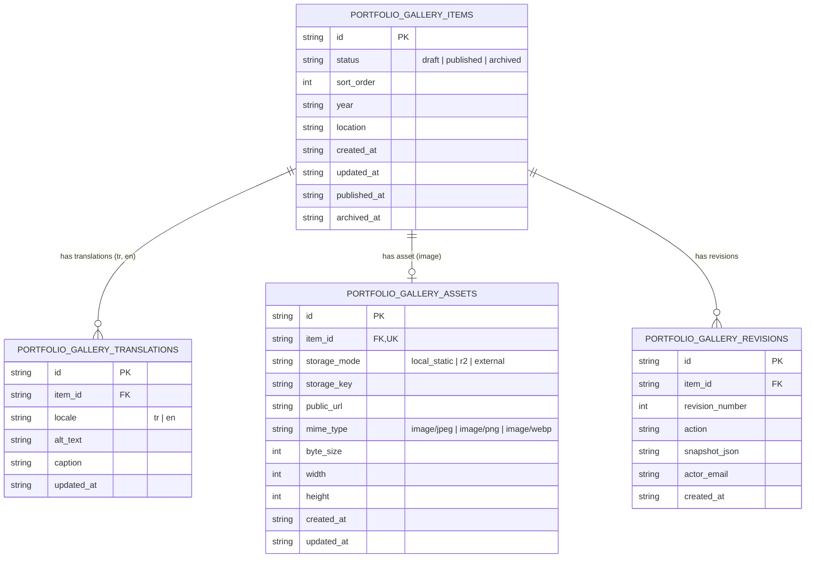

# Portfolio OS Phase 4: Personal Gallery Data Model & Schema Specification

**Project:** Kerem Mıhçı Portfolio OS  
**Repository Branch:** `feature/cloudflare-cms-dashboard`  
**Migration File:** `cloudflare/portfolio-api/migrations/0003_personal_gallery_schema.sql`  
**Status:** **ACTIVE & VERIFIED IN LOCAL D1**  

---

## 1. Architectural Overview & Design Philosophy

The Personal Gallery CMS architecture follows the same battle-tested design patterns established in Phase 2 (Projects CMS) and Phase 3 (Videos & Reels CMS):

1. **Third Normal Form (3NF) Relational Separation**:
   - Core photograph record, localized text translations, physical media assets, and historical revisions are stored in distinct, normalized tables.
2. **Additive Non-Breaking Migration**:
   - Zero modifications to existing tables (`projects`, `project_translations`, `project_media`, `portfolio_videos`, `portfolio_video_translations`, `portfolio_video_assets`, `admin_sessions`, `audit_logs`).
3. **Strict Cascading Foreign Keys**:
   - Deleting a parent photograph record cleanly cascades and purges its associated translations, asset records, and revision logs.
4. **Deterministic Ordering Indices**:
   - Compound index on `(status, sort_order ASC, id ASC)` enables zero-overhead querying of published photographs in exact sequential order.
5. **Magic Byte Binary Verification**:
   - Binary media assets are validated at the byte signature level, rejecting masqueraded files or unauthorized MIME types before storage.

---

## 2. Entity-Relationship Diagram



---

## 3. Detailed Table Specifications

### 3.1 `portfolio_gallery_items` (Core Photograph Entity)

Holds the lifecycle state, display sequence, and contextual capture metadata of each photograph.

| Column | Type | Constraints | Description |
| :--- | :--- | :--- | :--- |
| `id` | `TEXT` | `PRIMARY KEY` | Unique photograph identifier (e.g., `gallery-photo-1792528963565`). |
| `status` | `TEXT` | `NOT NULL DEFAULT 'draft'` | Publication lifecycle: `'draft'`, `'published'`, or `'archived'`. |
| `sort_order` | `INTEGER` | `NOT NULL DEFAULT 0` | Deterministic vertical stream sequence (ascending). |
| `year` | `TEXT` | `NULL` | Capture year (e.g., `"2025"`). |
| `location` | `TEXT` | `NULL` | Capture location (e.g., `"Kadıköy, İstanbul"`). |
| `created_at` | `TEXT` | `NOT NULL` | ISO 8601 creation timestamp. |
| `updated_at` | `TEXT` | `NOT NULL` | ISO 8601 last update timestamp. |
| `published_at` | `TEXT` | `NULL` | ISO 8601 timestamp of first/current publication. |
| `archived_at` | `TEXT` | `NULL` | ISO 8601 timestamp when archived. |

---

### 3.2 `portfolio_gallery_translations` (Localized Text Content)

Stores Turkish and English alt text (accessibility / SEO) and optional captions.

| Column | Type | Constraints | Description |
| :--- | :--- | :--- | :--- |
| `id` | `TEXT` | `PRIMARY KEY` | Unique translation key (e.g., `gallery-photo-1:tr`). |
| `item_id` | `TEXT` | `NOT NULL REFERENCES portfolio_gallery_items(id) ON DELETE CASCADE` | Foreign key referencing parent photograph. |
| `locale` | `TEXT` | `NOT NULL CHECK (locale IN ('tr', 'en'))` | Language code. |
| `alt_text` | `TEXT` | `NOT NULL DEFAULT ''` | Required descriptive alt text for accessibility and screen readers. |
| `caption` | `TEXT` | `NOT NULL DEFAULT ''` | Optional artistic or contextual caption displayed below photograph. |
| `updated_at` | `TEXT` | `NOT NULL` | ISO 8601 timestamp. |

*Unique Constraint:* `UNIQUE(item_id, locale)` ensures at most one translation per locale for each photograph.

---

### 3.3 `portfolio_gallery_assets` (Physical Media Bindings)

Stores file metadata, storage location keys, MIME signatures, and dimensions for the photograph image.

| Column | Type | Constraints | Description |
| :--- | :--- | :--- | :--- |
| `id` | `TEXT` | `PRIMARY KEY` | Unique asset ID (e.g., `asset-gallery-photo-1`). |
| `item_id` | `TEXT` | `NOT NULL REFERENCES portfolio_gallery_items(id) ON DELETE CASCADE` | Foreign key referencing parent photograph. |
| `storage_mode` | `TEXT` | `NOT NULL CHECK (storage_mode IN ('local_static', 'r2', 'external'))` | Storage provider backing the file. |
| `storage_key` | `TEXT` | `NOT NULL` | Physical storage key (e.g., `gallery/photo-1/image.webp`). |
| `public_url` | `TEXT` | `NOT NULL` | Public URL path for client-side rendering. |
| `mime_type` | `TEXT` | `NOT NULL CHECK (mime_type IN ('image/jpeg', 'image/png', 'image/webp'))` | Validated MIME type. |
| `byte_size` | `INTEGER` | `NOT NULL DEFAULT 0` | Exact binary size in bytes (max 10 MB). |
| `width` | `INTEGER` | `NULL` | Image pixel width. |
| `height` | `INTEGER` | `NULL` | Image pixel height. |
| `created_at` | `TEXT` | `NOT NULL` | ISO 8601 creation timestamp. |
| `updated_at` | `TEXT` | `NOT NULL` | ISO 8601 last update timestamp. |

*Unique Constraint:* `UNIQUE(item_id)` enforces a single primary high-resolution photograph per gallery record.

---

### 3.4 `portfolio_gallery_revisions` (Audit Trail & Point-in-Time Snapshots)

Records every mutation made to the photograph, storing a complete JSON snapshot for instant point-in-time rollbacks.

| Column | Type | Constraints | Description |
| :--- | :--- | :--- | :--- |
| `id` | `TEXT` | `PRIMARY KEY` | Unique revision identifier (e.g., `rev-photo-1-1`). |
| `item_id` | `TEXT` | `NOT NULL REFERENCES portfolio_gallery_items(id) ON DELETE CASCADE` | Foreign key referencing parent photograph. |
| `revision_number` | `INTEGER` | `NOT NULL` | Monotonically increasing revision sequence (1, 2, 3...). |
| `action` | `TEXT` | `NOT NULL` | Mutation action label (e.g., `'create'`, `'update'`, `'rollback'`). |
| `snapshot_json` | `TEXT` | `NOT NULL` | Complete serialized JSON state of the photograph at revision time. |
| `actor_email` | `TEXT` | `NOT NULL` | Email of the authenticated admin who triggered the change. |
| `created_at` | `TEXT` | `NOT NULL` | ISO 8601 revision timestamp. |

---

## 4. Indices & Performance Optimization

Five dedicated indices are created to guarantee sub-millisecond query performance in Cloudflare D1:

```sql
-- 1. Fast published stream lookup with deterministic ordering
CREATE INDEX IF NOT EXISTS idx_portfolio_gallery_status_sort
  ON portfolio_gallery_items(status, sort_order ASC, id ASC);

-- 2. Localized translation join lookup
CREATE INDEX IF NOT EXISTS idx_portfolio_gallery_translations_lookup
  ON portfolio_gallery_translations(item_id, locale);

-- 3. Media asset binding lookup
CREATE INDEX IF NOT EXISTS idx_portfolio_gallery_assets_lookup
  ON portfolio_gallery_assets(item_id);

-- 4. Reverse storage key lookup for media authorization
CREATE INDEX IF NOT EXISTS idx_portfolio_gallery_assets_storage_key
  ON portfolio_gallery_assets(storage_key);

-- 5. Reverse chronological revision history lookup
CREATE INDEX IF NOT EXISTS idx_portfolio_gallery_revisions_lookup
  ON portfolio_gallery_revisions(item_id, revision_number DESC);
```

---

## 5. Media Upload Contract & Magic Byte Verification

All photograph uploads are strictly validated prior to disk or R2 persistence:

1. **Maximum File Size**: 10 MB (`10,485,760` bytes). Exceeding uploads return `HTTP 400 Bad Request`.
2. **Permitted MIME Types**: `image/jpeg`, `image/png`, `image/webp`. All others (e.g., `video/mp4`, `text/html`) are rejected with `HTTP 400 Bad Request`.
3. **Magic Byte Signature Inspection**:
   - **JPEG**: Header starts with `FF D8 FF`
   - **PNG**: Header starts with `89 50 4E 47 0D 0A 1A 0A`
   - **WebP**: Header starts with `52 49 46 46` (`RIFF`) and bytes 8-11 contain `57 45 42 50` (`WEBP`)
   - Mismatches between declared MIME type and actual byte signature fail immediately.
4. **Storage Key Format**:  
   `gallery/{item_id}/{timestamp}-{cleanFileName}`

---

## 6. Public Adapter & Store Hydration

The public website renders gallery items via `GalleryApp.tsx`. The API returns an adapted `GalleryItem` structure compatible with existing components:

```typescript
export interface GalleryItem {
  id: string;
  src: string;
  alt: {
    tr: string;
    en: string;
  };
  caption?: {
    tr: string;
    en: string;
  };
  year?: string;
  location?: string;
  sortOrder?: number;
  aspectRatio?: string;
}
```

### Ordering Determinism in `sessionStore.ts`

When CMS mode is active, `hydrateGallery(items, isCmsMode = true)` strictly sorts items by:
```typescript
resolvedGallery.sort((a, b) => {
  const aOrder = (a as unknown as { sortOrder?: number }).sortOrder ?? 0;
  const bOrder = (b as unknown as { sortOrder?: number }).sortOrder ?? 0;
  return aOrder - bOrder || a.id.localeCompare(b.id);
});
```
This guarantees that the exact vertical sequence curated by the portfolio owner in the Studio OS admin dashboard is reproduced deterministically for every visitor on both desktop and mobile without PRNG shuffling.
