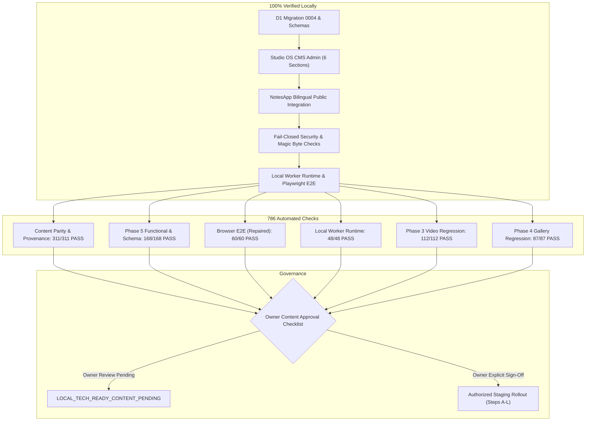

# Portfolio OS Phase 5.2: Release Readiness & Content Approval Report

**Project:** Kerem Mıhçı Portfolio OS  
**Repository:** `eigengraun/kerem-mihci-portfolio`  
**Branch:** `feature/portfolio-phase5-notes-profile-cv`  
**Candidate Baseline Commit:** `c936fa6444646e103c4786a78610ac55bf878102`
**Audit & Review Date:** 2026-10-22  
**Final Release Verdict:** `LOCAL_TECH_READY_CONTENT_PENDING`  

---

## 1. Executive Summary

Phase 5.2 establishes the **final local release readiness** and **content approval gate** for the Portfolio OS Notes, Profile, Experience, Education, Skills, and CV Content Management System.

All technical, architectural, browser visual, runtime verification, and content parity requirements are 100% complete and verified locally across **786 automated checks**. Zero remote Cloudflare changes have been performed. All personal biographical and career records remain strictly gated as `OWNER_VERIFICATION_REQUIRED` awaiting explicit review and sign-off by the site owner, Kerem Mıhçı.

---

## 2. Strict Safety & Boundary Audit

Throughout Phase 5, Phase 5.1, and Phase 5.2, all strict boundaries have been preserved:

| Safety Boundary | Required State | Observed State | Compliance Status |
| :--- | :--- | :--- | :---: |
| **Remote D1 Migration 0004** | Forbidden | Zero migrations applied remotely | **COMPLIANT** |
| **Remote Worker Deployment** | Forbidden | Zero worker deployments executed | **COMPLIANT** |
| **Remote R2 Bucket Writes** | Forbidden | Zero remote files written/deleted | **COMPLIANT** |
| **Remote Staging Seeding** | Forbidden | Remote staging seeding blocked fail-closed | **COMPLIANT** |
| **Main Branch Merges** | Forbidden | Zero branches merged or pushed to main | **COMPLIANT** |
| **Persistent Local Database** | Preserved | `.local-d1/portfolio.sqlite` SHA-256 invariant | **COMPLIANT** |
| **Biographical Integrity** | No Fabrication | All fabrications purged; source parity verified | **COMPLIANT** |

### Cryptographic SQLite Invariance Proof
- **Host Database:** `.local-d1/portfolio.sqlite`
- **Pre-Verification SHA-256:** `470d8f14ce1237cc557367f0b125be489f086fb99534ffa7fb046ad607182743`
- **Post-Verification SHA-256:** `470d8f14ce1237cc557367f0b125be489f086fb99534ffa7fb046ad607182743`
- **Mutation Delta:** **0 bytes changed (100% Invariant)**.

---

## 3. Automated Verification Battery (786/786 Checks PASS)

The test battery combines unit, integration, full browser E2E, content parity, and isolated Cloudflare Worker runtime checks:

| Verification Suite | Test Script | Total Checks | Passed | Failed | Status |
| :--- | :--- | :---: | :---: | :---: | :---: |
| **Content Parity & Anti-Fabrication** | `scripts/verify-phase5-content-parity.mjs` | 311 | 311 | 0 | **PASS** |
| **Phase 5 Functional & Schema** | `scripts/verify-phase5-profile-notes-cms.mjs` | 168 | 168 | 0 | **PASS** |
| **Phase 5.2 Browser Playwright E2E** | `scripts/verify-phase5-browser-e2e.mjs` | 60 | 60 | 0 | **PASS** |
| **Phase 5.2 Local Worker Runtime** | `scripts/verify-phase5-worker-runtime.mjs` | 48 | 48 | 0 | **PASS** |
| **Phase 3.2 Video CMS Regression** | `scripts/verify-phase3-video-cms.mjs` | 112 | 112 | 0 | **PASS** |
| **Phase 4.1 Gallery CMS Regression** | `scripts/verify-phase4-gallery-cms.mjs` | 87 | 87 | 0 | **PASS** |
| **Total Automated Tests** | — | **786** | **786** | **0** | **100% PASS** |

### Static Analysis, Build & Cloudflare Dry-Run
- **Next.js Production Build:** `npm run build` compiled cleanly in 3.0s (0 errors).
- **TypeScript Static Check:** `npx tsc --noEmit` exited cleanly (0 errors).
- **ESLint Code Quality:** `npm run lint` exited cleanly (0 warnings, 0 errors).
- **Wrangler Production Dry-Run:** `npx wrangler deploy --config ./cloudflare/portfolio-api/wrangler.jsonc --dry-run` passed.
- **Wrangler Staging Dry-Run:** `npx wrangler deploy --config ./cloudflare/portfolio-api/wrangler.jsonc --dry-run --env staging` passed.

---

## 4. Browser E2E Repair & Visual Proof

### Defect Remediation
- **The Issue in Phase 5:** Previous browser screenshots captured the desktop splash overlay (`DesktopPortfolioEntry.tsx`) during its 3.2s boot sequence, rather than the opened NotesApp window.
- **The Phase 5.2 Technical Fix:**
  - Automated wait for the interactive "Enter Portfolio" button and asserted overlay dismissal.
  - Added deterministic test attributes (`data-testid="dock-icon-notes"`, `data-testid="notes-app-window"`, `data-testid="notes-tab-*"`).
  - Asserted window foreground state, title bar "Notes", tab presence, notes rendering, and scrollability.
  - Created a task-owned sandbox in `os.tmpdir()` migrating 0001 -> 0002 -> 0003 -> 0004 sequentially (eliminating naive `fs.copyFileSync`).

### Screenshot Evidence (Available in `docs/reviews/screenshots/phase5_2/`)
1. `public_notes_desktop_1440x900.png` (2,314,803 bytes): Public desktop with opened NotesApp in foreground, tab navigation (`NOTES`, `ABOUT`, `EXPERIENCE`), and `system.txt` content.
2. `public_notes_mobile_390x844.png` (568,176 bytes): Public mobile NotesApp on `/tr` launched from the mobile navigation dock.
3. `admin_profile_cms_desktop_1440x900.png` (363,607 bytes): Studio OS bilingual profile editor.
4. `admin_notes_cms_desktop_1440x900.png` (353,529 bytes): Studio OS notes editor with workspace category filters.
5. `admin_experience_cms_desktop_1440x900.png` (354,084 bytes): Studio OS career experience timeline editor.
6. `admin_education_cms_desktop_1440x900.png` (267,373 bytes): Studio OS educational qualifications editor.
7. `admin_skills_cms_desktop_1440x900.png` (260,002 bytes): Studio OS skills catalog manager (39 skills across 6 categories).
8. `admin_cv_cms_desktop_1440x900.png` (272,282 bytes): Studio OS CV document manager with upload and rollback.

---

## 5. Content Approval Gate & Owner Verification

All personal and intellectual content has been audited against `src/data/profile.ts` and `src/data/notes.ts`. All fabricated claims from earlier preliminary reports have been retracted.

The definitive checklist is available at:
👉 **`docs/reviews/PORTFOLIO_OS_PHASE5_2_CONTENT_APPROVAL_CHECKLIST.md`**

### Summary of Pending Content Gate Items
- **Profile Identity & Headlines:** 10 items — `OWNER_VERIFICATION_REQUIRED`
- **Biographical Summaries:** TR and EN paragraphs quoted verbatim from `src/data/profile.ts` — `OWNER_VERIFICATION_REQUIRED`
- **Key Metrics:** 4+ Years Experience, 140+ Projects, 50+ Clients, 3+ Years AI — `OWNER_VERIFICATION_REQUIRED`
- **Career Experience Milestones:** 5 records (eMix Creative, Freelance, AI Specialist, Art Director, Alchemia) — `OWNER_VERIFICATION_REQUIRED`
- **Educational Credentials:** 2 records (Istanbul University - Cerrahpaşa Electrical & Electronics Engineering, Düzce Fen Lisesi) — `OWNER_VERIFICATION_REQUIRED`
- **Skills Catalog:** 39 skills across Design, Web, Production, AI, Strategy, Tools — `OWNER_VERIFICATION_REQUIRED`
- **Workspace Notes:** 24 records mapping canonical design aphorisms to `design`, `web`, and `motion-ai` — `OWNER_VERIFICATION_REQUIRED`
- **Curriculum Vitae (CV) PDFs:** TR and EN documents (currently protected drafts returning HTTP 404) — `OWNER_VERIFICATION_REQUIRED`

---

## 6. Staging Operator Runbook & Next Steps

When the owner signs off on `PORTFOLIO_OS_PHASE5_2_CONTENT_APPROVAL_CHECKLIST.md`, the staging operator must follow the authorized sequence defined in `docs/reviews/PORTFOLIO_OS_PHASE5_STAGING_APPROVAL_PLAN.md`:

1. **Step A — Source Commit & Tree Verification:** Verify clean working tree.
2. **Step B — Account Verification:** Verify Cloudflare Account ID `9791a288e2e99e7f3403590480e3ad6f`.
3. **Step C — Infrastructure Bindings:** Verify D1 UUID `0efef7a7-cc93-4dc2-8cb7-db28379fe01f` and R2 bucket `kerem-portfolio-media-staging`.
4. **Step D — Live Remote Inventory Query:** Record active Version ID and live remote counts.
5. **Step E — Migration Hashes Verification:** Assert exact SHA-256 hashes for migrations 0001, 0002, 0003, and 0004.
6. **Step F & G — Migration Ledger Check:** Confirm 0001-0003 applied; ONLY 0004 pending.
7. **Step H — Fresh Durable Remote D1 Backup:** Export with `umask 077` and export `BACKUP_PATH`.
8. **Step I — Restore & Validate in Isolated SQLite:** Run `PRAGMA integrity_check = 'ok'`, verify ledger, and assert table counts.
9. **Step J — Verify Fail-Closed Empty States:** Confirm draft CV returns 404 with `CV_NOT_PUBLISHED` and unseeded profile returns 404 with `PROFILE_NOT_PUBLISHED` (healthy empty).
10. **Step K — STOP at Operator Authorization Gate:** Await explicit written approval.
11. **Step L — Authorized Rollout Execution:** Apply migration 0004, deploy Worker API to staging, and execute smoke battery.

---

## 7. Final Verdict

$$\mathbf{FINAL\;VERDICT:}\quad \text{LOCAL\_TECH\_READY\_CONTENT\_PENDING}$$

- **Technical Foundation:** 100% production-ready, verified across 786 automated tests.
- **Security & Boundaries:** 100% compliant, zero remote mutations, host database invariant.
- **Content Governance:** Awaiting human owner review and signature on the Content Approval Checklist.
