# Portfolio OS Phase 5: Profile, Notes, Experience, Education, Skills & CV Data Model & Schema Specification

**Project:** Kerem Mıhçı Portfolio OS  
**Repository Branch:** `feature/portfolio-phase5-notes-profile-cv`  
**Migration File:** `cloudflare/portfolio-api/migrations/0004_profile_notes_cv_schema.sql`  
**Status:** **ACTIVE & VERIFIED LOCALLY (STAGING DEPLOYMENT PENDING USER APPROVAL)**  

---

## 1. Architectural Overview & Design Philosophy

The Phase 5 CMS architecture unifies all remaining personal identity, workspace notes, professional milestones, and CV documents into a centralized, fully relational bilingual engine within Cloudflare D1 and Studio OS.

The architecture strictly adheres to core Portfolio OS invariants:

1. **Third Normal Form (3NF) Relational Separation**:
   - Every entity separates core metadata, dual-locale translations (`tr`, `en`), and immutable audit revisions.
2. **Additive Non-Breaking Migration (0004)**:
   - Migration `0004_profile_notes_cv_schema.sql` creates 16 new normalized tables and 14 compound indices.
   - Zero structural or data mutations occur on Migration 0001 (`projects`), Migration 0002 (`portfolio_videos`), or Migration 0003 (`portfolio_gallery_items`). All existing 30 projects, 21 videos, and 3 gallery items remain completely intact.
3. **Strict Cascading Foreign Keys**:
   - Deleting a parent workspace note, experience item, education entry, or CV document cascades cleanly, purging child translations and revisions without leaving orphaned records.
4. **Workspace Isolation Guarantee**:
   - `portfolio_workspace_notes` are partitioned by `workspace_id IN ('design', 'web', 'motion-ai')`. Notes created in one workspace never appear in or leak into another workspace.
5. **Magic Byte PDF Security**:
   - CV documents are validated at the binary level enforcing `%PDF-` signature (`0x25 0x50 0x44 0x46 0x2D`), a 15 MB ceiling, and draft-state access isolation. Draft CVs return HTTP 404 with `Cache-Control: no-store` to prevent premature leakage.

---

## 2. Entity-Relationship Diagram

```mermaid
erDiagram
    PORTFOLIO_PROFILE ||--o{ PORTFOLIO_PROFILE_TRANSLATIONS : "has translations (tr, en)"
    PORTFOLIO_PROFILE ||--o{ PORTFOLIO_PROFILE_REVISIONS : "has revision history"

    PORTFOLIO_WORKSPACE_NOTES ||--o{ PORTFOLIO_WORKSPACE_NOTES_TRANSLATIONS : "has translations (tr, en)"
    PORTFOLIO_WORKSPACE_NOTES_REVISIONS }o--|| PORTFOLIO_WORKSPACE_NOTES : "workspace revisions"

    PORTFOLIO_EXPERIENCE ||--o{ PORTFOLIO_EXPERIENCE_TRANSLATIONS : "has translations (tr, en)"
    PORTFOLIO_EXPERIENCE ||--o{ PORTFOLIO_EXPERIENCE_REVISIONS : "has revisions"

    PORTFOLIO_EDUCATION ||--o{ PORTFOLIO_EDUCATION_TRANSLATIONS : "has translations (tr, en)"
    PORTFOLIO_EDUCATION ||--o{ PORTFOLIO_EDUCATION_REVISIONS : "has revisions"

    PORTFOLIO_SKILLS ||--o{ PORTFOLIO_SKILL_TRANSLATIONS : "has translations (tr, en)"

    PORTFOLIO_CV_DOCUMENTS ||--o{ PORTFOLIO_CV_REVISIONS : "has revisions"

    PORTFOLIO_PROFILE {
        string id PK "fixed: 'main'"
        string status "draft | published"
        string name
        string email
        string image_url
        string avatar_url
        string stats_json "JSON array of ProfileStat"
        string created_at
        string updated_at
        string published_at
    }

    PORTFOLIO_PROFILE_TRANSLATIONS {
        string id PK
        string profile_id FK
        string locale "tr | en"
        string headline
        string location
        string image_alt
        string summary_paragraphs_json "JSON string[]"
        string focus_areas_json "JSON string[]"
        string updated_at
    }

    PORTFOLIO_WORKSPACE_NOTES {
        string id PK
        string workspace_id "design | web | motion-ai"
        string status "draft | published | archived"
        int sort_order
        string filename
        string created_at
        string updated_at
        string published_at
    }

    PORTFOLIO_WORKSPACE_NOTES_TRANSLATIONS {
        string id PK
        string note_id FK
        string locale "tr | en"
        string title
        string content
        string updated_at
    }

    PORTFOLIO_EXPERIENCE {
        string id PK
        string status "draft | published | archived"
        string organization
        string start_date
        string category "work | freelance | ai | creative | volunteer"
        string skills_json "JSON string[]"
        int sort_order
        string created_at
        string updated_at
    }

    PORTFOLIO_EXPERIENCE_TRANSLATIONS {
        string id PK
        string experience_id FK
        string locale "tr | en"
        string role
        string end_date
        string location
        string employment_type
        string description
        string updated_at
    }

    PORTFOLIO_EDUCATION {
        string id PK
        string status "draft | published | archived"
        string start_year
        int sort_order
        string created_at
        string updated_at
    }

    PORTFOLIO_EDUCATION_TRANSLATIONS {
        string id PK
        string education_id FK
        string locale "tr | en"
        string institution
        string program
        string end_year
        string status_label
        string description
        string updated_at
    }

    PORTFOLIO_SKILLS {
        string id PK
        string category "design | web | production | ai | strategy | tools"
        string status "draft | published | archived"
        int sort_order
        string created_at
        string updated_at
    }

    PORTFOLIO_SKILL_TRANSLATIONS {
        string id PK
        string skill_id FK
        string locale "tr | en"
        string name
        string updated_at
    }

    PORTFOLIO_CV_DOCUMENTS {
        string id PK
        string locale "tr | en"
        string status "draft | published | archived"
        string storage_mode "local_static | r2 | external"
        string storage_key
        string public_url
        string filename
        string mime_type "application/pdf"
        int byte_size
        string sha256
        string created_at
        string updated_at
        string published_at
    }
```

---

## 3. Detailed Table Specifications

### 3.1. Profile Tables

#### `portfolio_profile`
Stores the single canonical personal profile identity.
- `id` (TEXT, PK): Fixed primary key `'main'`.
- `status` (TEXT): `'draft'` | `'published'`. Default `'published'`.
- `name` (TEXT): Full display name (e.g. `'Kerem Mıhçı'`).
- `email` (TEXT): Primary contact email (e.g. `'info@keremmihci.com'`).
- `image_url` (TEXT): High-resolution profile image path.
- `avatar_url` (TEXT): Lightweight desktop/dock icon avatar.
- `stats_json` (TEXT): JSON array of numeric/experiential highlights `[{ labelTR, labelEN, value }]`.
- `created_at`, `updated_at`, `published_at` (TEXT): ISO 8601 timestamps.

#### `portfolio_profile_translations`
Stores localized bio paragraphs, headlines, and focus areas.
- `id` (TEXT, PK): Unique translation identifier.
- `profile_id` (TEXT, FK): References `portfolio_profile(id) ON DELETE CASCADE`.
- `locale` (TEXT): `'tr'` | `'en'`. Unique constraint `(profile_id, locale)`.
- `headline` (TEXT): Professional title (e.g. `'Creative Director & Design Systems Architect'`).
- `location` (TEXT): Geographic base (e.g. `'Kadıköy, İstanbul'`).
- `image_alt` (TEXT): Accessibility text for the profile photograph.
- `summary_paragraphs_json` (TEXT): Array of strings containing formatted bio paragraphs.
- `focus_areas_json` (TEXT): Array of specialized capability chips.
- `updated_at` (TEXT): Timestamp.

#### `portfolio_profile_revisions`
Tracks every profile modification for one-click rollback.
- `id` (TEXT, PK)
- `profile_id` (TEXT, FK)
- `revision_number` (INTEGER): Strictly incremental.
- `action` (TEXT): `'create'` | `'update'` | `'rollback'`.
- `snapshot_json` (TEXT): Complete serialized profile state at time of modification.
- `actor_email` (TEXT): Email of the authenticated administrator.
- `created_at` (TEXT)

---

### 3.2. Workspace Notes Tables

#### `portfolio_workspace_notes`
Stores workspace-partitioned design notes, technical memos, and process articles.
- `id` (TEXT, PK): Unique slug or generated identifier.
- `workspace_id` (TEXT): `'design'` | `'web'` | `'motion-ai'`. Strict partition.
- `status` (TEXT): `'draft'` | `'published'` | `'archived'`.
- `sort_order` (INTEGER): Sequential order inside the active workspace.
- `filename` (TEXT): Virtual Markdown filename displayed in NotesApp (e.g. `grid-systems.md`).
- `created_at`, `updated_at`, `published_at` (TEXT)

#### `portfolio_workspace_notes_translations`
- `id` (TEXT, PK)
- `note_id` (TEXT, FK): References `portfolio_workspace_notes(id) ON DELETE CASCADE`.
- `locale` (TEXT): `'tr'` | `'en'`. Unique constraint `(note_id, locale)`.
- `title` (TEXT): Article title.
- `content` (TEXT): Full Markdown note content.
- `updated_at` (TEXT)

#### `portfolio_workspace_notes_revisions`
- `id` (TEXT, PK)
- `workspace_id` (TEXT): Revisions are tracked per workspace sequence.
- `revision_number` (INTEGER)
- `action` (TEXT)
- `snapshot_json` (TEXT): Complete workspace notes array snapshot.
- `actor_email` (TEXT)
- `created_at` (TEXT)

---

### 3.3. Experience Tables

#### `portfolio_experience`
- `id` (TEXT, PK)
- `status` (TEXT): `'draft'` | `'published'` | `'archived'`.
- `organization` (TEXT): Company or studio name (e.g. `'Eigengraun Studio'`).
- `start_date` (TEXT): Starting year or period (e.g. `'2020'`).
- `category` (TEXT): `'work'` | `'freelance'` | `'ai'` | `'creative'` | `'volunteer'`.
- `skills_json` (TEXT): JSON array of associated competencies.
- `sort_order` (INTEGER): Display sequence.
- `created_at`, `updated_at`, `published_at`, `archived_at` (TEXT)

#### `portfolio_experience_translations`
- `id` (TEXT, PK)
- `experience_id` (TEXT, FK): References `portfolio_experience(id) ON DELETE CASCADE`.
- `locale` (TEXT): `'tr'` | `'en'`. Unique `(experience_id, locale)`.
- `role` (TEXT): Job title.
- `end_date` (TEXT): End period or `'Present'` / `'Günümüz'`.
- `location` (TEXT)
- `employment_type` (TEXT): Full-time, Lead, Director, etc.
- `description` (TEXT): Detailed accomplishments and responsibilities.
- `updated_at` (TEXT)

#### `portfolio_experience_revisions`
- `id` (TEXT, PK)
- `experience_id` (TEXT, FK): References `portfolio_experience(id) ON DELETE CASCADE`.
- `revision_number` (INTEGER)
- `action` (TEXT)
- `snapshot_json` (TEXT)
- `actor_email` (TEXT)
- `created_at` (TEXT)

---

### 3.4. Education Tables

#### `portfolio_education`
- `id` (TEXT, PK)
- `status` (TEXT): `'draft'` | `'published'` | `'archived'`.
- `start_year` (TEXT)
- `sort_order` (INTEGER)
- `created_at`, `updated_at`, `published_at`, `archived_at` (TEXT)

#### `portfolio_education_translations`
- `id` (TEXT, PK)
- `education_id` (TEXT, FK): References `portfolio_education(id) ON DELETE CASCADE`.
- `locale` (TEXT): `'tr'` | `'en'`. Unique `(education_id, locale)`.
- `institution` (TEXT): University or academy name.
- `program` (TEXT): Degree program or field of study.
- `end_year` (TEXT)
- `status_label` (TEXT): `'Mezun'` | `'Graduated'`.
- `description` (TEXT)
- `updated_at` (TEXT)

#### `portfolio_education_revisions`
- `id` (TEXT, PK)
- `education_id` (TEXT, FK): References `portfolio_education(id) ON DELETE CASCADE`.
- `revision_number` (INTEGER)
- `action` (TEXT)
- `snapshot_json` (TEXT)
- `actor_email` (TEXT)
- `created_at` (TEXT)

---

### 3.5. Skills Tables

#### `portfolio_skills`
- `id` (TEXT, PK)
- `category` (TEXT): `'design'` | `'web'` | `'production'` | `'ai'` | `'strategy'` | `'tools'`.
- `status` (TEXT): `'draft'` | `'published'` | `'archived'`.
- `sort_order` (INTEGER)
- `created_at`, `updated_at` (TEXT)

#### `portfolio_skill_translations`
- `id` (TEXT, PK)
- `skill_id` (TEXT, FK): References `portfolio_skills(id) ON DELETE CASCADE`.
- `locale` (TEXT): `'tr'` | `'en'`. Unique `(skill_id, locale)`.
- `name` (TEXT): Localized skill name.
- `updated_at` (TEXT)

---

### 3.6. CV Document Tables

#### `portfolio_cv_documents`
- `id` (TEXT, PK)
- `locale` (TEXT): `'tr'` | `'en'`. Unique `(locale)`.
- `status` (TEXT): `'draft'` | `'published'` | `'archived'`.
- `storage_mode` (TEXT): `'local_static'` | `'r2'` | `'external'`.
- `storage_key` (TEXT): R2 object storage key (e.g. `cv/kerem-mihci-cv-en.pdf`).
- `public_url` (TEXT): Public download URL.
- `filename` (TEXT): Original uploaded filename.
- `mime_type` (TEXT): Strictly `'application/pdf'`.
- `byte_size` (INTEGER): File size in bytes (max 15,728,640 bytes).
- `sha256` (TEXT): Cryptographic SHA-256 checksum of the PDF file.
- `created_at`, `updated_at`, `published_at` (TEXT)

#### `portfolio_cv_revisions`
- `id` (TEXT, PK)
- `cv_id` (TEXT, FK): References `portfolio_cv_documents(id) ON DELETE CASCADE`.
- `revision_number` (INTEGER)
- `action` (TEXT)
- `snapshot_json` (TEXT)
- `actor_email` (TEXT)
- `created_at` (TEXT)

---

## 4. Indexing Strategy & Performance Guarantees

All queries execute in sub-millisecond time via indexed B-tree lookups:

1. `idx_portfolio_workspace_notes_lookup`: `(workspace_id, status, sort_order ASC, id ASC)`
2. `idx_portfolio_workspace_notes_rev`: `(workspace_id, revision_number DESC)`
3. `idx_portfolio_experience_status_sort`: `(status, sort_order ASC, id ASC)`
4. `idx_portfolio_experience_tr_lookup`: `(experience_id, locale)`
5. `idx_portfolio_experience_rev`: `(experience_id, revision_number DESC)`
6. `idx_portfolio_education_status_sort`: `(status, sort_order ASC, id ASC)`
7. `idx_portfolio_education_tr_lookup`: `(education_id, locale)`
8. `idx_portfolio_education_rev`: `(education_id, revision_number DESC)`
9. `idx_portfolio_skills_category_sort`: `(category, status, sort_order ASC, id ASC)`
10. `idx_portfolio_skill_tr_lookup`: `(skill_id, locale)`
11. `idx_portfolio_cv_locale`: `(locale, status)`
12. `idx_portfolio_cv_rev`: `(cv_id, revision_number DESC)`
13. `idx_portfolio_profile_rev`: `(profile_id, revision_number DESC)`

---

## 5. Security & Verification Invariants

1. **PDF Magic Bytes Enforcement**:
   All CV uploads are verified by reading the first 5 bytes of the buffer. Any upload without `%PDF-` signature is rejected with HTTP 400.
2. **Draft CV Access Isolation**:
   Unpublished CV records return HTTP 404 with `Cache-Control: no-store, no-cache, must-revalidate` to public visitors. Authenticated administrators can preview drafts with zero CDN caching.
3. **Fail-Closed Dual-Mode Repository**:
   When `CMS_STORAGE_MODE=remote` and remote Worker connectivity is unavailable, operations fail closed with `CmsStorageUnavailableError` (HTTP 503) without falling back to host database writes.
4. **Zero Host Database Pollution**:
   Automated verification suites (`verify-phase5-profile-notes-cms.mjs` and `verify-phase5-browser-e2e.mjs`) verify that `.local-d1/portfolio.sqlite` SHA-256 remains 100% identical before and after all test runs.
