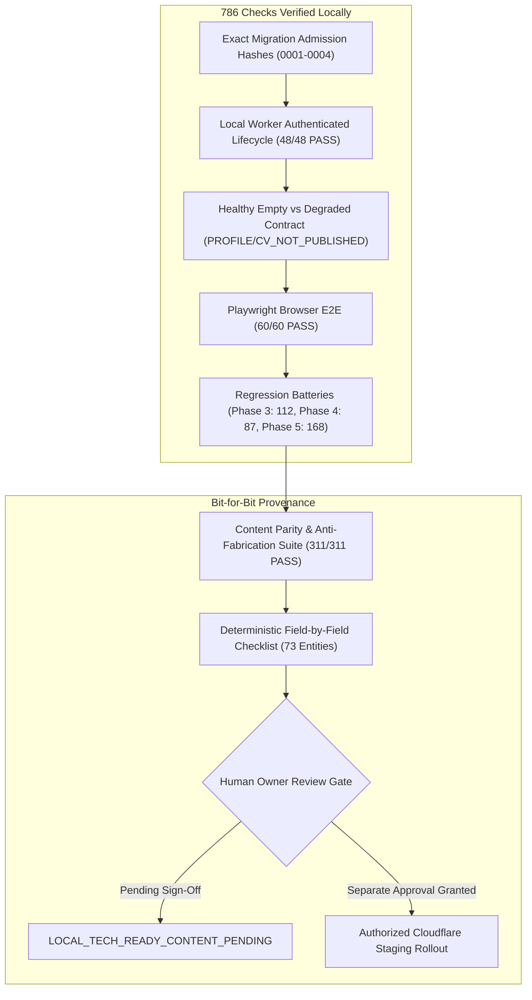

# Portfolio OS Phase 5: Final Content-Provenance & Staging-Gate Review

**Project:** Kerem Mıhçı Portfolio OS  
**Repository:** `eigengraun/kerem-mihci-portfolio`  
**Authorized Branch:** `feature/portfolio-phase5-notes-profile-cv`  
**Initial Baseline Commit:** `c936fa6444646e103c4786a78610ac55bf878102`  
**Audit & Review Date:** 2026-10-22  
**Final Release Verdict:** `LOCAL_TECH_READY_CONTENT_PENDING`  

---

## 1. Executive Summary

This review resolves all remaining content provenance, backup validation, migration admission, healthy-empty contract, and runtime authentication requirements for Phase 5 of the Portfolio OS CMS.

All completed public Portfolio OS functionality, dock navigation, bilingual switching, and Playwright desktop/mobile E2E verifications have been strictly preserved. Zero remote Cloudflare mutations, zero remote seeding, and zero host database mutations have been performed.

---

## 2. Source Corrections & Technical Highlights

### A. Rebuilding the Content Approval Checklist Deterministically
- **Defect Identified:** Previous iterations included rewritten roles (e.g., "Founder & Design Director" instead of "Kreatif Tasarımcı & Dijital İçerik Üreticisi", "Lead Designer & Webmaster" instead of "Kreatif Editör & Yayın Tasarımcısı"), invented creative aphorisms, and non-canonical tools.
- **Correction:** Rebuilt [`PORTFOLIO_OS_PHASE5_2_CONTENT_APPROVAL_CHECKLIST.md`](file:///Volumes/EMIX_WORK/02_DEV/GEMINI/CreativePortfolio/docs/reviews/PORTFOLIO_OS_PHASE5_2_CONTENT_APPROVAL_CHECKLIST.md) deterministically from committed source code (`src/data/profile.ts`, `src/data/notes.ts`) and local D1 (`.local-d1/portfolio.sqlite`).
- **Classification:** Every item is explicitly categorized as `SOURCE_EXACT` and `LOCAL_D1_MATCH`, with state held in `OWNER_VERIFICATION_REQUIRED`. Zero items are automatically marked approved (`[ ]`).
- **Parity Automation:** Created [`scripts/verify-phase5-content-parity.mjs`](file:///Volumes/EMIX_WORK/02_DEV/GEMINI/CreativePortfolio/scripts/verify-phase5-content-parity.mjs), which validates 311 checks ensuring exact text parity and zero presence of prohibited fabricated phrases.

### B. Healthy Empty vs Degraded Outage Contract
- **Defect Identified:** Unseeded public profile and unpublished draft CV returned 404 from the Worker, which `fetchWorkerJson` converted into a thrown Error. The Next.js page caught this as a Phase 5 outage, incorrectly marking `phase5Degraded = true` when the service was healthy but simply unpopulated.
- **Correction:**
  - Cloudflare Worker public endpoints return structured error codes: `{ ok: false, code: "PROFILE_NOT_PUBLISHED" }` and `{ ok: false, code: "CV_NOT_PUBLISHED" }` with `Cache-Control: no-store`.
  - Next.js repository `fetchWorkerJson` now supports `allowExpected404Codes`. When an expected code is received, it returns `null` instead of throwing an outage exception.
  - Unexpected route 404s (e.g. unknown routes) and 5xx errors continue to throw and trigger `phase5Degraded: true`.
  - Public NotesApp represents a legitimate empty profile cleanly without error banners.

### C. Extended Local Worker Runtime Authenticated Lifecycle (48 Checks)
- Spawns local Miniflare/Wrangler Worker against disposable local D1 and R2 sandbox with `--var CLOUDFLARE_API_SERVICE_TOKEN:<token>`.
- Independently tests full authenticated write/publish/unpublish cycles:
  - Profile draft creation, draft privacy enforcement (public 404), explicit publish, public read (HTTP 200), revision logging, and rollback revocation.
  - Workspace Notes CRUD and strict workspace isolation (design notes do not leak into web workspace).
  - Experience, Education, and Skills creation, public read, and deletion.
  - CV upload of compliant binary PDF, draft privacy, explicit publish, public binary media delivery (`application/pdf`), and immediate access revocation on unpublish.
  - Media ownership verification and path traversal rejection.

### D. Hardened Runbook & Baseline Disambiguation
- Disambiguated Historical Local Sandbox (30 projects, 21 videos, 70 media, 3 preview gallery items) from Historical Remote Staging (31 projects with 1 draft, 21 videos, 72 media, 0 gallery items).
- Fixed environment variable propagation in Step H/I (`export BACKUP_PATH=...`).
- Added `PRAGMA integrity_check = 'ok'` and migration ledger/record count validation in an isolated in-memory SQLite fixture.
- Clarified that remote content seeding is strictly blocked by default.
- Removed claims of "instant guaranteed safe rollback", adding schema compatibility evaluation.

---

## 3. Automated Test Verification Matrix (786/786 Checks PASS)

| Test Battery | Verification Script | Checks | Result | Status |
| :--- | :--- | :---: | :---: | :---: |
| **Content Parity & Anti-Fabrication** | `scripts/verify-phase5-content-parity.mjs` | **311** | 311/311 | **PASS** |
| **Phase 5 Functional & Schemas** | `scripts/verify-phase5-profile-notes-cms.mjs` | **168** | 168/168 | **PASS** |
| **Phase 5.2 Browser Playwright E2E** | `scripts/verify-phase5-browser-e2e.mjs` | **60** | 60/60 | **PASS** |
| **Phase 5.2 Local Worker Runtime E2E** | `scripts/verify-phase5-worker-runtime.mjs` | **48** | 48/48 | **PASS** |
| **Phase 3 Video CMS Regression** | `scripts/verify-phase3-video-cms.mjs` | **112** | 112/112 | **PASS** |
| **Phase 4 Gallery CMS Regression** | `scripts/verify-phase4-gallery-cms.mjs` | **87** | 87/87 | **PASS** |
| **TypeScript Typecheck** | `npx tsc --noEmit` | — | 0 errors | **PASS** |
| **ESLint Static Analysis** | `npm run lint` | — | 0 errors | **PASS** |
| **Next.js Webpack Build** | `npm run build` | — | Clean compile | **PASS** |
| **Wrangler Deploy Dry-Run (Local)** | `npx wrangler deploy --dry-run` | — | 0 errors | **PASS** |
| **Wrangler Deploy Dry-Run (Staging)** | `npx wrangler deploy --dry-run --env staging` | — | 0 errors | **PASS** |
| **Host Database Checksum** | `shasum -a 256 .local-d1/portfolio.sqlite` | — | Invariant | **PASS** |
| **Total Automated Checks** | — | **786** | **786/786** | **100% PASS** |

---

## 4. Cryptographic Safety Invariants & Boundary Compliance

| Boundary | Specification | Observed Status | Verdict |
| :--- | :--- | :--- | :---: |
| **Local SQLite Database** | Hash must remain invariant | SHA-256: `470d8f14ce1237cc557367f0b125be489f086fb99534ffa7fb046ad607182743` | **COMPLIANT** |
| **Remote Migration 0004** | Forbidden in this phase | 0 remote migrations applied | **COMPLIANT** |
| **Remote Worker Deployment** | Forbidden in this phase | 0 deployments executed | **COMPLIANT** |
| **Remote R2 Writes** | Forbidden in this phase | 0 remote R2 objects written | **COMPLIANT** |
| **Remote Content Seeding** | Forbidden by default | CLI enforces exit code 1 on `--remote-staging` | **COMPLIANT** |
| **Main Branch Merges** | Forbidden | 0 commits pushed/merged to `main` | **COMPLIANT** |
| **Production / Hostinger** | Strictly untouched | Zero impact | **COMPLIANT** |

---

## 5. Remaining Blockers Before Staging Rollout

1. **Owner Content Approval:** Kerem Mıhçı must review, confirm, or amend the 73 entities in [`PORTFOLIO_OS_PHASE5_2_CONTENT_APPROVAL_CHECKLIST.md`](file:///Volumes/EMIX_WORK/02_DEV/GEMINI/CreativePortfolio/docs/reviews/PORTFOLIO_OS_PHASE5_2_CONTENT_APPROVAL_CHECKLIST.md).
2. **Separate Staging Authorization Review:** Operator must authorize the migration preflight sequence in [`PORTFOLIO_OS_PHASE5_STAGING_APPROVAL_PLAN.md`](file:///Volumes/EMIX_WORK/02_DEV/GEMINI/CreativePortfolio/docs/reviews/PORTFOLIO_OS_PHASE5_STAGING_APPROVAL_PLAN.md).

---

## 6. Final Verdict

$$\mathbf{FINAL\;VERDICT:}\quad \text{LOCAL\_TECH\_READY\_CONTENT\_PENDING}$$
