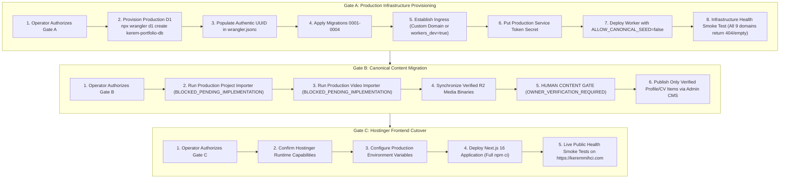

# Portfolio OS Phase 6 — Production Release Architecture & Cutover Plan

**Document Version:** 2.1.0 (Phase 6 Final Hardened Operational Runbook)
**Supersedes:** Version 2.0.0 (Pre-Hardening Draft) and Version 1.0.0 (`CMS_PRODUCTION_CUTOVER_PLAN.md`)
**Target Environment:** Production (`https://keremmihci.com`)
**Hosting Provider:** Hostinger (Node.js Next.js Application Engine)
**Edge Engine:** Cloudflare Workers, Cloudflare D1, Cloudflare R2
**Framework Baseline:** Next.js 16.3.0, React 19.2.8, Tailwind CSS v4, Zustand 5
**Current Release Verdict:** `PHASE6_QA_COMPLETE_PRODUCTION_PLAN_REVIEW_READY`
**Operational Status:** Strictly Gated — No Production Mutations Authorized

> [!CAUTION]
> **STRICT OPERATIONAL SAFETY BOUNDARY**
> This document is an authoritative engineering blueprint and executable runbook. **NO PRODUCTION RESOURCES ARE CREATED OR MUTATED IN THIS PHASE.**
> Live production (`https://keremmihci.com`) currently serves legacy static files on Hostinger.
> Execution of any provisioning, data migration, or cutover step requires separate, explicit, human-authorized gate approval.

---

## 1. Authoritative Audit of Current Production Resources

Based on direct, read-only Cloudflare API and authoritative DNS inspections:

| Resource Type | Resource Identifier | Current State / Configuration | Release Implication |
| :--- | :--- | :--- | :--- |
| **Cloudflare Account** | `9791a288e2e99e7f3403590480e3ad6f` | Verified active (`kerem.mihci@ogr.iuc.edu.tr`). | Target account for all production infrastructure. |
| **Worker Script** | `kerem-mihci-portfolio-api` | **DOES NOT EXIST** (`code: 10007`). | Provisioning deferred to authorized Gate A. |
| **D1 Database** | `kerem-portfolio-db` | **DOES NOT EXIST**. Only staging DB exists (`0efef7a7-cc93-4dc2-8cb7-db28379fe01f`). | Creation deferred to authorized Gate A. |
| **R2 Bucket** | `kerem-portfolio-media` | **EXISTS** (Created `2026-10-19T21:56:28.176Z`). Clean, empty/unseeded. | Production media target exists. |
| **Wrangler Config** | `env.production` | `"database_id": "REPLACE_WITH_PRODUCTION_D1_DATABASE_ID"`, `"workers_dev": false`. | Unprovisioned placeholder; ingress must be established. |
| **Apex Domain DNS** | `keremmihci.com` | Delegated to `ns1.dns-parking.com`, `ns2.dns-parking.com` (Hostinger DNS). | Cloudflare does NOT control zone DNS. |
| **API Domain DNS** | `api.keremmihci.com` | **DOES NOT RESOLVE** (No DNS record). | Requires CNAME setup or `workers.dev` routing. |
| **Media Domain DNS**| `media.keremmihci.com` | **DOES NOT RESOLVE** (Fictional legacy concept). | **REMOVED**. Next.js proxies media via `/api/media`. |

---

## 2. Target Production Architecture & Ingress Strategy

```
                                  +-------------------------------------------------------+
                                  |               Public Internet Visitors                |
                                  +---------------------------+---------------------------+
                                                              |
                                                              | HTTPS (Port 443 / TLS 1.3)
                                                              v
                                  +-------------------------------------------------------+
                                  |               Hostinger Production Node.js            |
                                  |                  Next.js 16 / React 19                |
                                  |                `https://keremmihci.com`               |
                                  +-------+---------------------------------------+-------+
                                          |                                       |
                   Internal Server Fetch  |                                       | Media Proxy Route
               (CLOUDFLARE_CMS_API_URL    |                                       | `GET /api/media/[...key]`
                + Service Token Auth)     |                                       | (Byte-Range + 206 Streaming)
                                          v                                       v
+-------------------------------------------------------------------------------------------------------------------------+
|                                              Cloudflare Worker Edge API                                                 |
|                                             `kerem-mihci-portfolio-api`                                                 |
|                          (Fail-Closed, Rate Limited, Scrypt Auth, ALLOW_CANONICAL_SEED=false)                           |
+---------------------------------------------+-------------------------------------------+-------------------------------+
                                              |                                           |
                                              | Bound SQL Interface                       | Native Bound Object Storage
                                              v                                           v
                              +---------------+---------------+           +---------------+---------------+
                              |    Cloudflare D1 Database     |           |  Cloudflare R2 Media Bucket   |
                              |     `kerem-portfolio-db`      |           |    `kerem-portfolio-media`    |
                              | (Migrations 0001-0004 Schema) |           | (High Durability Object Store)|
                              +-------------------------------+           +-------------------------------+
```

### 2.1 Production Worker Ingress Options
Because the apex domain `keremmihci.com` uses Hostinger nameservers, Cloudflare Zone Routes (`*api.keremmihci.com/*`) cannot route traffic automatically. Two verified architectural options exist:

* **Option A — Cloudflare Custom Domain + Hostinger CNAME (Recommended for Branded API):**
  1. In Cloudflare Dashboard: Worker `kerem-mihci-portfolio-api` -> **Settings** -> **Domains & Routes** -> **Add Custom Domain** -> `api.keremmihci.com`.
  2. Cloudflare provisions edge TLS certificate for `api.keremmihci.com`.
  3. In Hostinger DNS Zone Editor: Add CNAME record `api` pointing to `api.keremmihci.com.cdn.cloudflare.net` (or Cloudflare-assigned target).
  4. Next.js server configuration: `CLOUDFLARE_CMS_API_URL=https://api.keremmihci.com`.

* **Option B — Cloudflare Workers.dev Route (Recommended for Server-to-Server Isolation):**
  1. Update `wrangler.jsonc` `env.production`: set `"workers_dev": true`.
  2. Worker is assigned `https://kerem-mihci-portfolio-api.<subdomain>.workers.dev`.
  3. Next.js server configuration: `CLOUDFLARE_CMS_API_URL=https://kerem-mihci-portfolio-api.<subdomain>.workers.dev`.
  4. **Benefit:** Zero DNS configuration required in Hostinger; API is completely internal between Hostinger Next.js and Cloudflare edge.

> [!IMPORTANT]
> **FAIL-CLOSED ROUTING INVARIANT**
> If `workers_dev` remains `false` without an authorized Custom Domain or Route, the production Worker will have **zero ingress URLs**. In that state, deployment or cutover is strictly rejected by the release gate.

### 2.2 R2 Media Routing Architecture
- `media.keremmihci.com` is **fictional** and has been **permanently eliminated**.
- Public media assets (project images, responsive video posters, gallery items, CV PDFs) are fetched through the Next.js streaming proxy route: `src/app/api/media/[...key]/route.ts`.
- Next.js fetches upstream from `${CLOUDFLARE_CMS_API_URL}/api/v1/public/media/${key}` using HTTP Range requests and streams chunks directly to clients with `Accept-Ranges: bytes` and `Cache-Control: public, max-age=31536000, immutable`.
- `R2_PUBLIC_BASE_URL` in Hostinger environment must remain empty `""` or set to `https://keremmihci.com/api/media`.

---

## 3. Approved Database Schema & Migration Sequence

Production D1 database initialization requires applying the exact sequence of 4 versioned migrations:

| Order | Migration Filename | Cryptographic SHA-256 Hash | Schema Domains Created |
| :---: | :--- | :--- | :--- |
| **1** | `0001_initial_schema.sql` | `453593cdcf472f41e8504ad95ca9f941225562310a30009b68ea492c83479bcf` | Projects, translations, media, categories, services, revisions, publishing events, audit logs, admin sessions, rate limits. |
| **2** | `0002_videos_and_reels_schema.sql` | `2c3ac9ff453d76e5afa2e980fcb08fdf08f3362a5a1a9a347634549f5b098f64` | `portfolio_videos`, `portfolio_video_translations`, `portfolio_video_assets`, `portfolio_video_revisions`. |
| **3** | `0003_personal_gallery_schema.sql` | `da6aaabf624fbbaee35089ad27c8627e8709e7e570713d7c29ca6c1b403af606` | `portfolio_gallery_items`, `portfolio_gallery_translations`, `portfolio_gallery_assets`, `portfolio_gallery_revisions`. |
| **4** | `0004_profile_notes_cv_schema.sql` | `cc6e699e703db6527427d99ff490793b40564d21d8681fceec7e48c81dbe537d` | `portfolio_profile`, `portfolio_workspace_notes`, `portfolio_experience`, `portfolio_education`, `portfolio_skills`, `portfolio_cv_documents` (+ translations & revisions). |

**Total Production Tables:** 36 Relational Tables
**Total Explicit Indexes:** 34 Performance and Isolation Indexes
**Destructive DDL Permitted:** ZERO. All migrations are purely additive (`CREATE TABLE IF NOT EXISTS`, `CREATE INDEX IF NOT EXISTS`).

---

## 4. Decoupled Three-Gate Release Model

The release sequence is decoupled into three independent gates. No gate may proceed without explicit human authorization:



---

## 5. Detailed Operational Runbook

### Gate A: Production Infrastructure Provisioning (Zero Content Seeding)

#### Step A.1 — Create Production D1 Database
```bash
cd cloudflare/portfolio-api
npx wrangler d1 create kerem-portfolio-db
```
Capture the generated UUID from stdout (e.g. `xxxxxxxx-xxxx-xxxx-xxxx-xxxxxxxxxxxx`).

#### Step A.2 — Update Production Configuration
Update `cloudflare/portfolio-api/wrangler.jsonc`:
1. Replace `"database_id": "REPLACE_WITH_PRODUCTION_D1_DATABASE_ID"` with the authentic D1 UUID.
2. Select ingress strategy:
   - For `workers.dev` direct ingress: set `"workers_dev": true` under `"env.production"`.
   - For Custom Domain: configure domain in Cloudflare dashboard and define `routes` / `custom_domains`.

#### Step A.3 — Apply Migrations 0001–0004 to Remote Production D1
```bash
npx wrangler d1 migrations apply kerem-portfolio-db --env production --remote
```
*Validation:* Verify output reports 4 migrations applied, 0 errors.

#### Step A.4 — Generate and Store Production Service Token
Generate a cryptographically secure 64-character token:
```bash
PROD_SERVICE_TOKEN=$(openssl rand -hex 32)
echo "$PROD_SERVICE_TOKEN" | npx wrangler secret put CLOUDFLARE_API_SERVICE_TOKEN --env production
```

#### Step A.5 — Deploy Production Cloudflare Worker
Deploy the verified Worker code with `ALLOW_CANONICAL_SEED=false`:
```bash
npx wrangler deploy -c cloudflare/portfolio-api/wrangler.jsonc --env production
```

#### Step A.6 — Verify Infrastructure Health (Read-Only)
Probe the reachable Worker endpoint directly:
```bash
# Verify Worker health
curl -s -f "$PROD_WORKER_URL/api/v1/public/health" | grep '"ok":true'

# Verify unseeded tables return 404 or empty results with no-store
curl -s -o /dev/null -w "%{http_code}" "$PROD_WORKER_URL/api/v1/public/profile" # Expects 404
curl -s -o /dev/null -w "%{http_code}" "$PROD_WORKER_URL/api/v1/public/projects" # Expects 200 []
```

---

### Gate B: Canonical Content Migration (Zero Public Frontend Cutover)

#### Step B.1 — Production Project Migration (`BLOCKED_PENDING_IMPLEMENTATION`)
> [!CAUTION]
> **REJECTED COMMAND REMOVED**
> `npm run cms:migrate` has been completely **REMOVED** from the production workflow. Running it mutates local SQLite and attempts to hit `/api/v1/admin/seed` which returns HTTP 403 (`ALLOW_CANONICAL_SEED=false`).
> **Status:** Project migration is `BLOCKED_PENDING_IMPLEMENTATION` until a dedicated, idempotent production importer (`scripts/import-canonical-projects-to-production-d1.mjs`) is authorized and implemented.
>
> **Required Future Importer Specification:**
> 1. Requires explicit target validation (must strictly check production D1 UUID).
> 2. Provides mandatory `--dry-run` mode with detailed record diffs.
> 3. Does not use `/api/v1/admin/seed`; writes via authenticated administrative endpoints or direct D1 batch statements.
> 4. Idempotently upserts canonical records while strictly preserving editorial revisions.
> 5. Requires cryptographic validation of source data (`src/data/projects.ts`).

#### Step B.2 — Production Video Migration (`NOT_IMPLEMENTED`)
> [!CAUTION]
> **REJECTED COMMAND REMOVED**
> `node scripts/import-canonical-videos-to-d1.mjs --remote-production --execute` has been completely **REMOVED**. Running it fails closed with `FATAL: Unrecognized CLI argument "--remote-production"`.
> **Status:** Video migration is `NOT_IMPLEMENTED` until a dedicated production target is authorized in the script.
>
> **Required Future Importer Specification:**
> 1. Validates production Worker and D1 database identifiers against authorized manifest.
> 2. Enforces `--dry-run` as default; `--execute` requires explicit confirmation flag.
> 3. Validates 21 canonical video records against `src/data/videos.ts` SHA-256 hash.
> 4. Non-destructive: will not overwrite existing production editorial records without `--force`.

#### Step B.3 — Production Media Synchronization Contract
- Source assets: Local canonical images/videos under `public/projects/`, `public/videos/`, `public/gallery/`.
- Target: Cloudflare R2 bucket `kerem-portfolio-media`.
- Verification protocol:
  1. Compute SHA-256 hash and MIME type for each asset in local manifest.
  2. Perform `HEAD` requests on target R2 keys to check existing ETags.
  3. Upload only missing or modified objects (idempotent, zero deletion of unrelated objects).
  4. Perform sample `GET` requests with `Range: bytes=0-1023` to verify partial content streaming.

#### Step B.4 — Human Content Governance Gate (`OWNER_VERIFICATION_REQUIRED`)
> [!IMPORTANT]
> **MANDATORY CONTENT APPROVAL**
> Personal biographical narrative, education history, work experience, workspace notes, and CV PDFs must NOT be seeded automatically from legacy source files (`src/data/profile.ts`).
> The human owner must review `docs/reviews/PORTFOLIO_OS_PHASE5_2_CONTENT_APPROVAL_CHECKLIST.md` and explicitly publish approved items via the Studio OS Admin CMS.

---

### Gate C: Hostinger Frontend Cutover & Live DNS

#### Step C.1 — Verify Hostinger Environment Capabilities (`HOSTINGER_CAPABILITY_UNVERIFIED`)
Before triggering a production deployment on Hostinger, the operator must verify:
1. **Hosting Plan Type:** VPS vs Cloud vs Shared Hosting.
2. **Process Manager:** Confirm PM2 or systemd is supported and installed.
3. **Node.js Engine:** Confirm Node.js >= 20.9.0 is installed.
4. **Git Auto-Deploy Configuration:** Determine if Hostinger webhooks auto-deploy on push to `main`. If auto-deploy is active, merging PR to `main` triggers immediate build!

#### Step C.2 — Configure Hostinger Production Environment Variables
In the Hostinger application environment configuration:
```env
NODE_ENV=production
NEXT_PUBLIC_SITE_URL=https://keremmihci.com
CMS_STORAGE_MODE=production
CMS_DATA_SOURCE=cloudflare
CLOUDFLARE_CMS_API_URL=<REACHABLE_PRODUCTION_WORKER_URL>
CLOUDFLARE_API_SERVICE_TOKEN=<PROD_SERVICE_TOKEN>
ADMIN_SESSION_SECRET=<SECURE_64_CHAR_HEX>
ADMIN_ALLOWED_EMAILS=kerem@keremmihci.com
ADMIN_PASSWORD_HASH=<SCRYPT_HASH>
R2_PUBLIC_BASE_URL=
```
*Note: `R2_PUBLIC_BASE_URL` is deliberately empty. Media is proxied by Next.js.*

#### Step C.3 — Build and Deploy Next.js Application on Hostinger
> [!IMPORTANT]
> **DO NOT USE `--omit=dev` BEFORE BUILD**
> `next build` requires `typescript` and `@types/*` packages located in `devDependencies`. Stripping devDependencies before building causes TypeScript compilation failure.

```bash
# Correct Hostinger deployment sequence:
git pull origin main
npm ci
npm run build
pm2 reload kerem-portfolio --update-env || pm2 start npm --name "kerem-portfolio" -- start
```

---

## 6. Corrected Post-Deployment Verification Battery

Probe the **actual** endpoints exposed by the Next.js production frontend on `https://keremmihci.com`:

| Test Target | Endpoint / Route | Expected HTTP Status & Payload Assertions |
| :--- | :--- | :--- |
| **Next.js Turkish Page** | `GET https://keremmihci.com/tr` | HTTP 200, valid HTML, localized metadata. |
| **Next.js English Page** | `GET https://keremmihci.com/en` | HTTP 200, valid HTML, localized metadata. |
| **Next.js Media Proxy** | `GET https://keremmihci.com/api/media/projects/...` | HTTP 200 / 206, `Accept-Ranges: bytes`, valid media stream. |
| **Next.js Public Profile**| `GET https://keremmihci.com/api/v1/public/profile` | HTTP 200 (if approved & published) OR HTTP 404 with `Cache-Control: no-store`. |
| **Next.js Public Gallery**| `GET https://keremmihci.com/api/v1/public/gallery` | HTTP 200, clean JSON array. |
| **Next.js Public Projects**| `GET https://keremmihci.com/api/projects` | HTTP 200, returns canonical projects list. |
| **Next.js Public Videos** | `GET https://keremmihci.com/api/videos` | HTTP 200, returns canonical videos list. |
| **Next.js Admin Auth** | `POST https://keremmihci.com/api/admin/auth` | Enforces rate limiting, CSRF protection, Scrypt auth. |
| **Worker Direct Health** | `GET $PROD_WORKER_URL/api/v1/public/health` | HTTP 200, `{"ok":true,"environment":"production"}`. |

*Note: Calling `https://keremmihci.com/api/v1/public/health` directly is intentionally excluded because Next.js has no public health API route; health is verified via page responses and direct Worker health probes.*

---

## 7. Disaster Recovery & Rollback Strategy

### 7.1 Scenario 1: Worker Edge API Failure / Outage
- **Symptom:** Worker returns HTTP 5xx, 521, or times out.
- **Fail-Closed Behavior:** Next.js gracefully handles Worker errors, rendering empty CMS states with `Cache-Control: no-store`.
- **Immediate Fallback Option:** Set `CMS_DATA_SOURCE=legacy` in Hostinger `.env` and restart (`pm2 reload kerem-portfolio --update-env`).
- **CRITICAL ROLLBACK RISK WARNING:**
  > [!WARNING]
  > Falling back to `CMS_DATA_SOURCE=legacy` causes Next.js to read from `src/data/profile.ts`. This file contains legacy biographical claims that have **NOT** been approved under `OWNER_VERIFICATION_REQUIRED`. The operator must be aware that legacy fallback exposes unverified biographical data.

### 7.2 Scenario 2: Worker Version Rollback
- Revert the Worker script to the previous stable Version ID:
  ```bash
  npx wrangler rollback --env production
  ```
- **Limitation:** `wrangler rollback` reverts only the Worker script and environment bindings. It does **NOT** rollback D1 database records or R2 bucket media.

### 7.3 Scenario 3: Database Data Corruption / Recovery
- **Forbidden:** Never restore raw full SQL dumps directly over a populated, live production D1 database.
- **Safe Recovery Protocol:**
  1. Export current production state: `npx wrangler d1 export kerem-portfolio-db --env production --output=./backups/prod-snapshot.sql`.
  2. Inspect state in isolated local SQLite sandbox.
  3. Formulate targeted, transaction-wrapped reconciliation scripts.
  4. Apply minimal corrective SQL statements.
