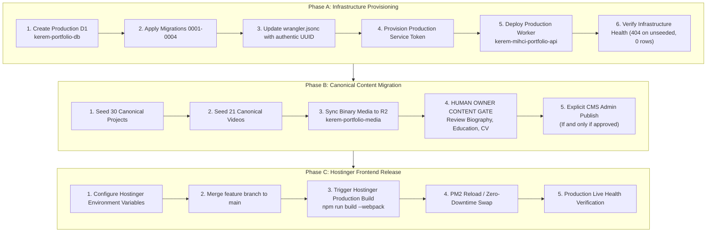

# Portfolio OS Phase 6 — Production Release Architecture & Cutover Plan

**Document Version:** 2.0.0 (Phase 6 Post-Hardening Comprehensive Specification)
**Supersedes:** `docs/reviews/CMS_PRODUCTION_CUTOVER_PLAN.md` (Version 1.0 — Stale)
**Target Environment:** Production (`https://keremmihci.com`)
**Production Hosting Provider:** Hostinger (Node.js Next.js Application Engine)
**Edge Engine:** Cloudflare Workers, Cloudflare D1, Cloudflare R2
**Framework Baseline:** Next.js 16.3.0, React 19.2.8, Tailwind CSS v4, Zustand 5
**Current Release Gate:** `PHASE6_QA_PASS_CONTENT_PENDING` (STOPPED at Production Approval Gate)

> [!CAUTION]
> **STRICT OPERATIONAL SAFETY BOUNDARY**
> This document is an architectural blueprint and runbook. **NO PRODUCTION RESOURCES ARE CREATED OR MUTATED IN THIS PHASE.**
> Live production (`https://keremmihci.com`) currently serves canonical static files on Hostinger.
> Execution of any step in this plan requires explicit, separate human operator authorization.

---

## 1. Authoritative Audit of Current Production Cloudflare Resources

Based on direct, read-only Cloudflare API inspections:

| Resource Type | Cloudflare Resource Identifier | Current State in Account (`9791a288e2e99e7f...`) |
| :--- | :--- | :--- |
| **Worker Script** | `kerem-mihci-portfolio-api` | **DOES NOT EXIST** (`code: 10007`). Pending future provisioning. |
| **D1 Database** | `kerem-portfolio-db` | **DOES NOT EXIST**. Only staging database (`0efef7a7-cc93-4dc2-8cb7-db28379fe01f`) exists. |
| **R2 Bucket** | `kerem-portfolio-media` | **EXISTS** (Created `2026-10-19T21:56:28.176Z`). Clean, intact. |
| **Wrangler Config** | `env.production.d1_databases[0]` | Contains placeholder: `"database_id": "REPLACE_WITH_PRODUCTION_D1_DATABASE_ID"`. |

*Note: Database UUIDs and credentials are never fabricated. When `kerem-portfolio-db` is provisioned by the operator, its authentic UUID will be populated into `wrangler.jsonc`.*

---

## 2. Target Production Architecture

```
                  +-------------------------------------------------------+
                  |               Public Internet Visitors                |
                  +---------------------------+---------------------------+
                                              |
                   HTTPS (TLS 1.3)            | HTTPS (Static Media / Direct)
                                              v
           +----------------------------------+----------------------------------+
           |                                                                     |
           v                                                                     v
+-------------------------------+                                     +---------------------------------+
|       Hostinger Node.js       |                                     |    Cloudflare R2 Media Bucket   |
|     Next.js 16 / React 19     |                                     |     `kerem-portfolio-media`     |
|   `https://keremmihci.com`    |                                     +----------------+----------------+
+---------------+---------------+                                                      ^
                |                                                                      |
                | Server-to-Server Internal Fetch                                      |
                | (Bearer CLOUDFLARE_API_SERVICE_TOKEN)                                |
                v                                                                      |
+---------------+----------------------------------------------------------------------+----------------+
|                                    Cloudflare Worker API                                              |
|                              `kerem-mihci-portfolio-api`                                               |
|                    (Fail-Closed, Rate Limited, Origin-Checked, Scrypt Auth)                           |
+-----------------------------------------------+-------------------------------------------------------+
                                                |
                                                | Bound SQL Interface
                                                v
                                +---------------+---------------+
                                |     Cloudflare D1 Database    |
                                |      `kerem-portfolio-db`     |
                                |  (Relational 0001-0004 Schema)|
                                +-------------------------------+
```

### Architectural Principles
1. **Hostinger Next.js Frontend:** Hosts the public application, desktop window manager, SSR metadata, JSON-LD schemas, and Studio OS admin interface.
2. **Cloudflare Worker API:** Acts as the stateless, durable edge API for D1 queries, R2 asset streaming with byte ranges, admin session lifecycle, and rate limiting.
3. **Cloudflare D1:** Serverless SQLite database maintaining relational parity across all 9 CMS domains.
4. **Cloudflare R2:** High-durability object storage for project covers, responsive crops, personal gallery photography, and verified PDF curriculum vitae files.
5. **Fail-Closed Staging & Production Semantics:** When `CMS_STORAGE_MODE` is `staging` or `production`, the system strictly forbids silent local database fallbacks. Unseeded or missing resources return structured HTTP 404 responses with `Cache-Control: no-store`.

---

## 3. Approved Database Schema & Migration Sequence

Production D1 database initialization requires applying the exact sequence of 4 versioned migrations:

| Order | Migration Filename | Cryptographic SHA-256 Hash | Schema Domains Created |
| :---: | :--- | :--- | :--- |
| **1** | `0001_initial_schema.sql` | `453593cdcf472f41e8504ad95ca9f941225562310a30009b68ea492c83479bcf` | Projects, translations, media, categories, services, revisions, publishing events, audit logs, admin sessions, rate limits. |
| **2** | `0002_videos_and_reels_schema.sql` | `2c3ac9ff453d76e5afa2e980fcb08fdf08f3362a5a1a9a347634549f5b098f64` | `portfolio_videos`, `portfolio_video_translations`, `portfolio_video_assets`, `portfolio_video_revisions`. |
| **3** | `0003_personal_gallery_schema.sql` | `da6aaabf624fbbaee35089ad27c8627e8709e7e570713d7c29ca6c1b403af606` | `portfolio_gallery_items`, `portfolio_gallery_translations`, `portfolio_gallery_assets`, `portfolio_gallery_revisions`. |
| **4** | `0004_profile_notes_cv_schema.sql` | `cc6e699e703db6527427d99ff490793b40564d21d8681fceec7e48c81dbe537d` | `portfolio_profile`, `portfolio_workspace_notes`, `portfolio_experience`, `portfolio_education`, `portfolio_skills`, `portfolio_cv_documents` (+ translations & revisions). |

**Total Production Tables:** 36 Relational Tables
**Total Explicit Indexes:** 34 Performance and Isolation Indexes
**Destructive DDL Permitted:** ZERO. All migrations are purely additive (`CREATE TABLE IF NOT EXISTS`, `CREATE INDEX IF NOT EXISTS`).

---

## 4. Phase-by-Phase Production Provisioning Sequence

The production cutover is divided into three strictly gated phases:
- **Phase A:** Cloudflare Infrastructure Provisioning (Zero Content Mutation)
- **Phase B:** Canonical Content Seeding & Media Synchronization (Public Cutover Still Inactive)
- **Phase C:** Hostinger Frontend Release & Public DNS/Cache Activation



---

## 5. Detailed Operational Runbook

### Step 5.1 — Provision Production D1 Database
```bash
cd cloudflare/portfolio-api
npx wrangler d1 create kerem-portfolio-db
```
*Action:* Capture the generated UUID from stdout and update `cloudflare/portfolio-api/wrangler.jsonc`:
```jsonc
"env": {
  "production": {
    "d1_databases": [
      {
        "binding": "PORTFOLIO_DB",
        "database_name": "kerem-portfolio-db",
        "database_id": "<INSERT-NEW-PRODUCTION-UUID-HERE>",
        "migrations_dir": "migrations"
      }
    ]
  }
}
```

### Step 5.2 — Apply Database Migrations
```bash
npx wrangler d1 migrations apply kerem-portfolio-db --env production --remote
```
*Validation:* Verify 4 migrations applied, 0 pending, and exactly 36 tables created.

### Step 5.3 — Configure Production Worker Service Token
Generate a cryptographically secure 64-character secret and store it in Cloudflare Secrets:
```bash
npx wrangler secret put CLOUDFLARE_API_SERVICE_TOKEN --env production
```

### Step 5.4 — Deploy Production Cloudflare Worker
Deploy with `ALLOW_CANONICAL_SEED=false`:
```bash
npx wrangler deploy -c cloudflare/portfolio-api/wrangler.jsonc --env production
```
*Validation:* Execute read-only smoke probe against production Worker URL:
```bash
curl -I https://kerem-mihci-portfolio-api.<subdomain>.workers.dev/api/v1/public/health
```

### Step 5.5 — Seed Canonical Projects and Videos
Execute task-owned, idempotent CLI seed scripts targeting production:
```bash
# Seed 30 Canonical Projects
CLOUDFLARE_CMS_API_URL=<prod-worker-url> \
CLOUDFLARE_API_SERVICE_TOKEN=<prod-service-token> \
npm run cms:migrate

# Seed 21 Canonical Videos
node scripts/import-canonical-videos-to-d1.mjs --remote-production --execute
```
*Validation:* Query production health: `publishedCount: 30`, videos: `21`.

### Step 5.6 — Human Owner Content Approval Gate
> [!IMPORTANT]
> **MANDATORY CONTENT APPROVAL**
> Under NO CIRCUMSTANCES should personal biographical data, education, career experience, or CV PDFs be seeded automatically.
> The operator must review `docs/reviews/PORTFOLIO_OS_PHASE5_2_CONTENT_APPROVAL_CHECKLIST.md` and only publish approved items through the Studio OS Admin CMS.

### Step 5.7 — Configure Hostinger Environment Variables
In the Hostinger Application Dashboard or production `.env`:
```env
NODE_ENV=production
NEXT_PUBLIC_SITE_URL=https://keremmihci.com
CMS_STORAGE_MODE=production
CMS_DATA_SOURCE=cloudflare
CLOUDFLARE_CMS_API_URL=https://<production-worker-url>
CLOUDFLARE_API_SERVICE_TOKEN=<production-service-token>
ADMIN_SESSION_SECRET=<random-64-character-hex-secret>
ADMIN_ALLOWED_EMAILS=kerem@keremmihci.com
ADMIN_PASSWORD_HASH=scrypt:<saltHex>:<derivedKeyHex>
R2_PUBLIC_BASE_URL=https://media.keremmihci.com
```

### Step 5.8 — Merge, Build, and Deploy on Hostinger
1. Create Pull Request from `feature/portfolio-phase6-final-qa` into `main`.
2. Confirm all CI/pre-merge checks pass.
3. Merge PR into `main`.
4. On Hostinger server:
```bash
git pull origin main
npm ci --omit=dev
npm run build
pm2 reload kerem-portfolio --update-env
```

---

## 6. Disaster Recovery & Rollback Runbook

### Rollback Scenario 1: Worker API Failure
- **Symptom:** Worker returns HTTP 5xx or times out.
- **Immediate Mitigation:** Revert Hostinger configuration to legacy static fallback:
  ```env
  CMS_DATA_SOURCE=legacy
  ```
  Run `pm2 reload kerem-portfolio --update-env`.
  *Result:* The public site immediately serves authentic static data from `src/data/projects.ts` and `src/data/videos.ts` within seconds with zero user disruption.

### Rollback Scenario 2: Worker Version Rollback
- Revert the Worker to the previous stable Version ID:
  ```bash
  npx wrangler rollback --env production
  ```

### Rollback Scenario 3: Database Restoration
- Export current D1 state:
  ```bash
  npx wrangler d1 export kerem-portfolio-db --env production --output=./backups/prod-emergency-backup.sql
  ```
- Restore from verified pre-cutover snapshot using isolated sandbox validation.

---

## 7. Post-Deployment Verification Battery

Once public cutover occurs, execute the following assertions:
1. `GET https://keremmihci.com/api/v1/public/health` -> HTTP 200, `ok: true`.
2. `GET https://keremmihci.com/api/v1/public/projects` -> HTTP 200, 30 canonical projects.
3. `GET https://keremmihci.com/api/v1/public/videos` -> HTTP 200, 21 canonical videos.
4. `GET https://keremmihci.com/api/v1/public/gallery` -> HTTP 200, clean stream.
5. `GET https://keremmihci.com/api/v1/public/profile` -> Valid published profile OR structured 404 with `no-store` (zero leaking).
6. Verify Turkish (`/tr`) and English (`/en`) routes in Chrome, Safari, Firefox.
7. Verify Studio OS Admin login, CSRF tokens, and session expiration.
8. Verify Google Analytics 4 tracking event fires without blocking main thread.
