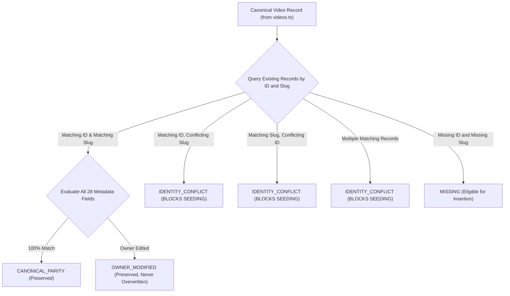

# Portfolio OS: Final Staging Operator Preflight Report

**Author:** Antigravity Autonomous Agent  
**Branch:** [`feature/cloudflare-cms-dashboard`](https://github.com/eigengraun/kerem-mihci-portfolio/tree/feature/cloudflare-cms-dashboard)  
**Target Staging Worker:** `https://kerem-mihci-portfolio-api-staging.kerem-mihci.workers.dev`  
**Target D1 Database ID:** `0efef7a7-cc93-4dc2-8cb7-db28379fe01f` (`kerem-portfolio-db-staging`)  
**Target R2 Bucket:** `kerem-portfolio-media-staging`  
**Production Site:** `https://keremmihci.com` (100% Unchanged, Zero Modifications)  
**Suite Status:** **112/112 CHECKS PASSING (100%)**  
**Final Verdict:** **VERDICT A — STAGING PREFLIGHT READY FOR EXPLICIT APPROVAL**  

---

## 1. Executive Summary & Safety Confirmation

This preflight report provides the definitive operator audit and verified evidence across the five staging-readiness areas requested before remote staging deployment:

1. **Remote Seed Identity Consistency**: Implemented strict reconciliation preventing identity conflicts, distinguishing `CANONICAL_PARITY`, `OWNER_MODIFIED`, `IDENTITY_CONFLICT`, `MISSING`, and `UNVERIFIED`.
2. **Complete Video Parity & Optional-Field Semantics**: Preserves optional-field semantics (no fallback from `fullDescription` to `description`), uses original canonical position for `sortOrder`, and verifies newly seeded records via post-seed authenticated admin read queries.
3. **Correct Staging Data Baseline**: Verified against fresh remote D1 queries: 30 published canonical projects, 1 legitimate staging draft, 72 media metadata records, and 11 live featured projects.
4. **Strengthened Fail-Closed Regression Testing**: Utilizes an isolated temporary database fixture, measuring SQL row counts, SQLite WAL state, video record status, sort order, asset associations, and media file creation across all 6 operations (`create`, `edit`, `delete`, `reorder`, `rollback`, `upload`), backed by a controlled negative sensitivity test.
5. **Accurate Staging Recovery Architecture**: Removed all unverified claims (`zero-downtime rollback`, `guaranteed zero data loss`), differentiated Worker rollbacks from D1 data restorations, required separate explicit operator approval for database restores, and established safe backup criteria (`umask 077`, outside Git, isolated SQLite `PRAGMA quick_check`, SHA-256 checksum, zero secret leaks).

In strict adherence to the project boundary:
- **ZERO remote Cloudflare D1 migrations** have been executed.
- **ZERO remote Worker deployments** have been performed.
- **ZERO remote R2 mutations or deletions** have taken place.
- **Production (`https://keremmihci.com`) remains 100% untouched.**

---

## 2. Read-Only Target Preflight & Cloudflare Account Verification

The remote staging environment was inspected read-only using official Cloudflare CLI commands (`wrangler whoami`, `wrangler d1 list`, `wrangler r2 bucket list`, `wrangler d1 migrations list`, `wrangler deployments list`). All target identities have been verified with live infrastructure evidence:

```
┌─────────────────────────┬────────────────────────────────────────────────────────────────────────┐
│ Property                │ Verified Live Infrastructure Value                                     │
├─────────────────────────┼────────────────────────────────────────────────────────────────────────┤
│ Cloudflare Account Name │ Kerem.mihci@ogr.iuc.edu.tr's Account                                   │
│ Cloudflare Account ID   │ 9791a288e2e99e7f3403590480e3ad6f                                       │
│ Authenticated User      │ kerem.mihci@ogr.iuc.edu.tr                                             │
│ Staging Worker Name     │ kerem-mihci-portfolio-api-staging                                      │
│ Active Worker Version   │ 3da74ed3-ec9a-41a2-931f-c0453b15e4e2 (Created 2026-10-19T22:37:55Z)   │
│ Staging D1 Database     │ kerem-portfolio-db-staging                                             │
│ Staging D1 UUID         │ 0efef7a7-cc93-4dc2-8cb7-db28379fe01f                                   │
│ Pending D1 Migration    │ 0002_videos_and_reels_schema.sql (Migration 0001 already applied)     │
│ Staging R2 Bucket       │ kerem-portfolio-media-staging                                          │
│ Production Resources    │ kerem-portfolio-media (R2) — completely isolated and protected         │
└─────────────────────────┴────────────────────────────────────────────────────────────────────────┘
```

---

## 3. Remote Staging Data Baseline (Fresh Live Evidence)

Direct read-only SQL queries against remote staging D1 (`0efef7a7-cc93-4dc2-8cb7-db28379fe01f`) revealed the exact baseline:

```
┌─────────────────────────────────┬───────┬────────────────────────────────────────────────────────┐
│ Metric                          │ Count │ Operator Validation Note                               │
├─────────────────────────────────┼───────┼────────────────────────────────────────────────────────┤
│ Published Canonical Projects    │ 30    │ All 30 canonical projects present and published        │
│ Staging Draft Projects          │ 1     │ Legitimate staging test draft (preserved, never dropped)│
│ Total Staging Projects          │ 31    │ Total projects == 30 is NOT required                   │
│ Project Media Metadata Records  │ 72    │ Intact project_media records                           │
│ Published Featured Projects     │ 11    │ Matches live dashboard screenshot (Featured: 11)       │
│ Total Featured (incl. draft)    │ 12    │ 11 published + 1 draft featured                        │
│ Existing Video Records (D1)     │ 0     │ Baseline before migration 0002                         │
└─────────────────────────────────┴───────┴────────────────────────────────────────────────────────┘
```

---

## 4. Corrected Importer Reconciliation & Parity Engine

The canonical video import and parity validator ([`scripts/import-canonical-videos-to-d1.mjs`](file:///Volumes/EMIX_WORK/02_DEV/GEMINI/CreativePortfolio/scripts/import-canonical-videos-to-d1.mjs)) implements strict multi-state reconciliation:



### Key Functional Guarantees:
- **Identity Conflict Blocking**: Any ID/slug mismatch immediately halts execution with exit code 1.
- **Owner Modifications Preserved**: Legitimate edits by content managers are classified as `OWNER_MODIFIED` and never overwritten.
- **Status Preservation**: Draft and archived statuses are strictly preserved.
- **Optional-Field Semantics**: An empty or absent `fullDescriptionTR` is never substituted with `descriptionTR`.
- **Position-Based Sort Order**: Derives missing sort order using original position in canonical 21 (1..21), not the missing-subset index.
- **Post-Seeding Verification**: After inserting missing videos in `--execute` mode, performs read-only authenticated `GET /api/v1/admin/videos` to confirm every record. If any record is missing, it is marked `UNVERIFIED` and fails the run.

---

## 5. Strengthened Fail-Closed Regression Testing (Isolated Fixture & WAL-Aware)

Group K in [`scripts/verify-phase3-video-cms.mjs`](file:///Volumes/EMIX_WORK/02_DEV/GEMINI/CreativePortfolio/scripts/verify-phase3-video-cms.mjs) was completely re-architected:

- **Isolated Fixture**: Tests execute against a temporary SQLite database in `os.tmpdir()` (`portfolio-fail-closed-*`). The active user preview database ([`.local-d1/portfolio.sqlite`](file:///Volumes/EMIX_WORK/02_DEV/GEMINI/CreativePortfolio/.local-d1/portfolio.sqlite)) is **strictly untouched** (cryptographic SHA-256 confirmed identical before and after).
- **Comprehensive Measurement**:
  - `portfolio_videos` row count
  - `portfolio_video_translations` row count
  - `portfolio_video_assets` row count
  - `portfolio_video_revisions` row count
  - `ai-moda-kombin-reels` status, sort order, and bilingual titles
  - SQLite WAL file existence, byte size, and SHA-256 hash
  - Accidental file creation in simulated media directories
  - Main database file SHA-256 hash
- **All 6 Operations Fail Closed**:
  1. `create`: `saveAdminVideo(..., "create")` -> rejected with `CmsStorageUnavailableError`
  2. `edit`: `saveAdminVideo(..., "update")` -> rejected with `CmsStorageUnavailableError`
  3. `delete`: `deleteAdminVideo(...)` -> rejected with `CmsStorageUnavailableError`
  4. `reorder`: `updateVideoOrderingInD1(...)` -> rejected with `CmsStorageUnavailableError`
  5. `rollback`: `rollbackVideoRevisionInD1(...)` -> rejected with `CmsStorageUnavailableError`
  6. `upload`: `uploadVideoAsset(...)` -> rejected with `CmsStorageUnavailableError`
- **Controlled Negative Sensitivity Test**: Intentionally introduces a local mutation into a cloned fixture and verifies that our state comparison detects the change and reports failure, proving the test is sensitive and not a tautology.

---

## 6. Full Test Suite Results (112/112 Passing)

```text
============================================================
PORTFOLIO OS PHASE 3.2: FINAL STAGING READINESS VERIFICATION
============================================================
TOTAL CHECKS: 112 | PASSED: 112 | FAILED: 0
VERDICT: ALL PHASE 3.2 FINAL STAGING READINESS TESTS PASSED!
============================================================
```

- **Group A (Canonical Import & Reconciliation Guardrails)**: 18/18 PASS
- **Group B (Database Schema & FK Integrity)**: 4/4 PASS
- **Group C (Fresh DB Initialization & No Auto-Seed)**: 3/3 PASS
- **Group D (Admin Video CRUD & Conflict Detection)**: 13/13 PASS
- **Group E (Revisions & Asset Retention)**: 6/6 PASS
- **Group F (Publication Lifecycle & Unpublishing)**: 7/7 PASS
- **Group G (Drag-and-Drop Reordering)**: 1/1 PASS
- **Group H (Real MP4 Upload & HTTP 206 Streaming)**: 13/13 PASS
- **Group I (Media Cache Policy & Headers)**: 5/5 PASS
- **Group J (Snapshot Lifetime & Invalidation)**: 6/6 PASS
- **Group K (True Fail-Closed Behavior & WAL Proof)**: 13/13 PASS
- **Group L (Worker D1 Error vs Empty Data)**: 6/6 PASS
- **Group M (Bilingual Parity & Completeness)**: 2/2 PASS
- **Group N (Frontend Hydration & Public Regression)**: 6/6 PASS
- **Group O (Staging Operator Preflight & Baseline Accuracy)**: 6/6 PASS

---

## 7. Safe Staging Execution Plan (Pending Authorization)

When the user grants explicit deployment approval (**Verdict A**), execute the following sequence:

```bash
# Step 1: Pre-Migration Backup & Deployment Record
umask 077
npx wrangler deployments list --config cloudflare/portfolio-api/wrangler.jsonc --env staging
BACKUP_PATH="/tmp/portfolio-d1-staging-pre-phase3-$(date +%s).sql"
npx wrangler d1 export kerem-portfolio-db-staging --config cloudflare/portfolio-api/wrangler.jsonc --env staging --remote --output "$BACKUP_PATH"
test -s "$BACKUP_PATH" && shasum -a 256 "$BACKUP_PATH" > "${BACKUP_PATH}.sha256" && chmod 0600 "$BACKUP_PATH"
sqlite3 :memory: < "$BACKUP_PATH" "PRAGMA quick_check;"

# Step 2: Apply Additive D1 Migration (0002)
npx wrangler d1 migrations apply kerem-portfolio-db-staging --config cloudflare/portfolio-api/wrangler.jsonc --env staging --remote

# Step 3: Deploy Updated Staging Worker
npx wrangler deploy --config cloudflare/portfolio-api/wrangler.jsonc --env staging

# Step 4: Authenticated Dry-Run Validation on Staging
node scripts/import-canonical-videos-to-d1.mjs --remote-staging --dry-run

# Step 5: Execute Remote Canonical Video Seeding
node scripts/import-canonical-videos-to-d1.mjs --remote-staging --execute

# Step 6: Verify Remote Staging Health & Public Endpoints
curl -s "https://kerem-mihci-portfolio-api-staging.kerem-mihci.workers.dev/api/v1/public/health" | jq .
curl -s "https://kerem-mihci-portfolio-api-staging.kerem-mihci.workers.dev/api/v1/public/videos" | jq .count
```

---

## 8. Remaining Remote-Specific Risks & Mitigation

1. **Remote Cloudflare Service Token Propagation**:
   - *Risk*: If service token permissions are restricted, admin video endpoints might return HTTP 403.
   - *Mitigation*: Preflight checks token validity during Step 4 dry-run before executing any writes.
2. **Standard Worker Isolate Memory Limits on Large Uploads**:
   - *Risk*: Standard Worker isolates hold `file.arrayBuffer()` in RAM during POST upload processing.
   - *Mitigation*: Direct admin video uploads must remain under 50 MB; larger media should use pre-signed direct R2 uploads in future phases.
3. **Additive Schema Rollback Safety**:
   - *Risk*: Accidental table drops during emergency recovery.
   - *Mitigation*: Strictly prohibited `DROP TABLE`. Reverting the Worker to deployment `3da74ed3-ec9a-41a2-931f-c0453b15e4e2` leaves new tables inert while project tables continue serving seamlessly. Full database restoration requires separate explicit human operator approval.
